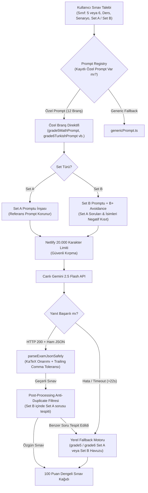
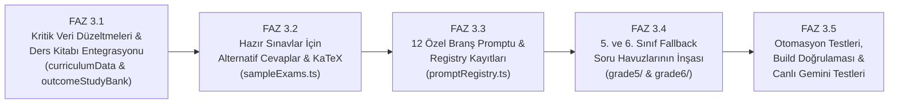

# OYSS 5. VE 6. SINIFLAR ORTAK EKSİKLER VE GELİŞTİRME YOL HARİTASI

**Rapor Kodu:** `13_ORTAK_EKSIKLER_VE_GELISTIRME_PLANI.md`  
**Kapsam:** 5. ve 6. Sınıflar (12 Sınıf-Branş Kombinasyonu)  
**Müfredat:** Türkiye Yüzyılı Maarif Modeli (TYMM)  
**Tarih:** 31 Ekim 2026  
**Durum:** Analiz Tamamlandı - Onay Bekliyor  

---

## 1. Kapsamlı Yönetici Özeti ve 12 Branş Durum Matrisi

OYSS projesinin 5. ve 6. sınıf geliştirme aşaması öncesinde, `~/Desktop/OYSS_KAYNAKLAR/` klasöründeki **36 adet resmî PDF dosyası** (24 ders kitabı, 12 MEBİ örnek sınavı) taranmış; mevcut OYSS kod tabanı (`curriculumData.ts`, `outcomeStudyBank.ts`, `sampleExams.ts`, `promptRegistry.ts`, `fallbackPools/`, `aiGeneratorEngine.ts`) ile karşılaştırmalı olarak analiz edilmiştir.

### 12 Sınıf-Branş Kombinasyonu Mevcut Durum Matrisi:

| No | Sınıf - Branş | Ders Kitabı Durumu | MEBİ Sınavı Durumu | Kazanım Kodu Uyumu | Ders Kitabı Sayfa Ref. | Hazır Sınav (sampleExams) | Alternatif Cevap (altAnswers) | Özel Prompt (Registry) | Fallback Havuzu |
|:---:|:---|:---:|:---:|:---:|:---:|:---:|:---:|:---:|:---:|
| 1 | **5. Sınıf Türkçe** | 2 Kitap (338 s.) | 13 Soru (13 s.) | Tam Uyumlu | Eksik (0/8) | 6 Sınav (38 Soru) | **0 / 38** | Yok (Generic) | Kısmi (İlkel) |
| 2 | **6. Sınıf Türkçe** | 2 Kitap (337 s.) | 11 Soru (12 s.) | Tam Uyumlu | Eksik (0/7) | 6 Sınav (37 Soru) | **0 / 37** | Yok (Generic) | **Yok (0 Soru)** |
| 3 | **5. Sınıf Matematik** | 2 Kitap (360 s.) | 17 Soru (29 s.) | Tam Uyumlu | Eksik (0/7) | 5 Sınav (32 Soru) | **0 / 32** | Yok (Generic) | **Yok (0 Soru)** |
| 4 | **6. Sınıf Matematik** | 2 Kitap (390 s.) | 15 Soru (12 s.) | Tam Uyumlu | Eksik (0/4) | 3 Sınav (12 Soru) | **0 / 12** | Yok (Generic) | **Yok (0 Soru)** |
| 5 | **5. Sınıf Fen Bilimleri** | 2 Kitap (322 s.) | 11 Soru (9 s.) | Tam Uyumlu | Eksik (0/4) | 4 Sınav (24 Soru) | **0 / 24** | Yok (Generic) | **Yok (0 Soru)** |
| 6 | **6. Sınıf Fen Bilimleri** | 2 Kitap (320 s.) | 12 Soru (14 s.) | Tam Uyumlu | Eksik (0/6) | 6 Sınav (34 Soru) | **0 / 34** | Yok (Generic) | **Yok (0 Soru)** |
| 7 | **5. Sınıf Sosyal Bilgiler** | 2 Kitap (304 s.) | 12 Soru (8 s.) | **HATA:** `SB.5.2.1` Tanımsız | Eksik (0/4) | 5 Sınav (32 Soru) | **0 / 32** | Yok (Generic) | **Yok (0 Soru)** |
| 8 | **6. Sınıf Sosyal Bilgiler** | 2 Kitap (303 s.) | 13 Soru (8 s.) | **HATA:** `SB.6.2.1` Tanımsız | Eksik (0/4) | 5 Sınav (31 Soru) | **0 / 31** | Yok (Generic) | **Yok (0 Soru)** |
| 9 | **5. Sınıf Din Kültürü** | 1 Kitap (198 s.) | 7 Soru (7 s.) | **HATA:** `Evrendeki` Yazımı | Eksik (0/5) | 4 Sınav (27 Soru) | **0 / 27** | Yok (Generic) | **Yok (0 Soru)** |
| 10 | **6. Sınıf Din Kültürü** | 1 Kitap (189 s.) | 7 Soru (7 s.) | Tam Uyumlu | Eksik (0/6) | 5 Sınav (30 Soru) | **0 / 30** | Yok (Generic) | **Yok (0 Soru)** |
| 11 | **5. Sınıf İngilizce** | 3 Kitap (433 s.) | 8 Soru (7 s.) | Tam Uyumlu | Eksik (0/6) | 5 Sınav (28 Soru) | **0 / 28** | Yok (Generic) | **Yok (0 Soru)** |
| 12 | **6. Sınıf İngilizce** | 3 Kitap (424 s.) | 9 Soru (10 s.) | Tam Uyumlu | Eksik (0/6) | 5 Sınav (31 Soru) | **0 / 31** | Yok (Generic) | **Yok (0 Soru)** |

---

## 2. Öncelikle Düzeltilmesi Gereken Kritik Veri Hataları

Analiz sırasında mevcut kod tabanında 3 adet doğrudan çalışma zamanı hatasına ve eksik veri problemine yol açan kritik kusur tespit edilmiştir:

### 1. Hata: 5. Sınıf Din Kültürü "Evrendeki" Kazanım Kodu Hatası
- **Konum:** `src/data/curriculumData.ts` (Satır ~663, Senaryo 1, Senaryo 2 ve Senaryo 4).
- **Mevcut Durum:** `{ outcomeCode: "Evrendeki", questionCount: 1, cognitiveLevel: "Basit Bilişsel Süreçler", notes: "Evrendeki Mükemmel Düzen" }`
- **Kök Neden:** İlk otomatik aktarım sırasında metin ayırıcı hatası nedeniyle `DKAB.5.1.1` kodu kesilmiş ve yerine metnin ilk kelimesi kod olarak kaydedilmiştir.
- **Düzeltme:**
  1. `curriculumData.ts` içindeki Senaryo 1, 2 ve 4'te `outcomeCode: "DKAB.5.1.1"` olarak güncellenmelidir.
  2. `OFFICIAL_OUTCOMES` sözlüğüne `DKAB.5.1.1`: "Evrendeki mükemmel düzene ilişkin akıl yürütebilme" kaydı eklenmelidir.
  3. `outcomeStudyBank.ts` içerisine `DKAB.5.1.1` için çalışma notları, çözümlü örnek ve pratik soru yazılmalıdır.

### 2. Hata: 5. Sınıf Sosyal Bilgiler `SB.5.2.1` Sözlük Eksikliği
- **Konum:** `src/data/curriculumData.ts`
- **Mevcut Durum:** Senaryo dağılımlarında `SB.5.2.1` kazanım kodu kullanılmıştır; ancak `OFFICIAL_OUTCOMES` sözlüğünde tanımlanmamıştır.
- **Kök Neden:** Kazanım sözlüğü oluşturulurken 2. öğrenme alanı atlanmıştır.
- **Düzeltme:**
  1. `OFFICIAL_OUTCOMES` sözlüğüne `SB.5.2.1`: "Yaşadığı ilin göreceli konum özelliklerini belirleyebilme" tanımı eklenmelidir.
  2. `outcomeStudyBank.ts` içerisine `SB.5.2.1` girdi olarak eklenmeli ve ders kitabının 50-57. sayfaları referans verilmelidir.

### 3. Hata: 6. Sınıf Sosyal Bilgiler `SB.6.2.1` Sözlük Eksikliği
- **Konum:** `src/data/curriculumData.ts`
- **Mevcut Durum:** Senaryo dağılımlarında `SB.6.2.1` kullanılmış, fakat `OFFICIAL_OUTCOMES` sözlüğünde bulunmamaktadır.
- **Düzeltme:**
  1. `OFFICIAL_OUTCOMES` sözlüğüne `SB.6.2.1`: "Ülkemizin, kıtaların ve okyanusların konum özelliklerini belirleyebilme" tanımı eklenmelidir.
  2. `outcomeStudyBank.ts` içerisine `SB.6.2.1` (Kıtalar, okyanuslar, Türkiye'nin jeopolitik konumu) eklenmeli ve ders kitabının 58-110. sayfaları referans verilmelidir.

---

## 3. 7. Sınıftan Aktarılacak Ortak Mimari Standartlar

FAZ 2.2 ve FAZ 2.3 süreçlerinde 7. sınıf özelinde geliştirdiğimiz ve canlı Gemini API üzerinde %100 başarıyla doğruladığımız mimari prensipler 5. ve 6. sınıflara aynen uygulanacaktır:



### Temel Mimari İlkeler:
1. **Set A Byte-for-Byte Dondurma İlkesi:** Set A promptları test referansları ile dondurulmalı, Set B eklemeleri Set A'yı asla değiştirmemelidir.
2. **Set B B+ Avoidance Akışı:** Set B üretilirken Set A sınavındaki soru kökleri, metin konuları, kahraman isimleri ve sayısal veriler `AVOID_QUESTIONS_PROMPT` bloğuyla modele negatif kısıt olarak verilmeli; post-processing filtresi kaçak benzerlikleri engellemelidir.
3. **Netlify 20.000 Karakter Eşiği:** Netlify functions gövde sınırına takılmamak için prompt uzunluğu 20.000 karakteri aştığında `truncatePromptContextSafely` ile bağlam güvenle kırpılmalıdır.
4. **JSON Parser Trailing Comma & KaTeX Toleransı:** Modelin KaTeX kaçış karakterlerini (`\\frac`, `\\cdot`) ve tekli trailing comma hatalarını güvenle onaran `jsonParser.ts` mimarisi korunacaktır.

---

## 4. Branşa Özgü Prompt ve Fallback İhtiyaç Matrisi

### A. Geliştirilecek Özel Prompt Dosyaları (12 Yeni Modül):
1. `src/generators/prompts/grade5TurkishPrompt.ts` (60-100 kelime, 5N1K, geleneksel oyunlar, Atatürk ve çiftlik)
2. `src/generators/prompts/grade6TurkishPrompt.ts` (80-140 kelime, Dîvânu Lugâti't-Türk, milli mücadele, atasözü/deyim)
3. `src/generators/prompts/grade5MathPrompt.ts` (Geometrik çizim tasvirleri, açı, dikme, KaTeX sembolleri)
4. `src/generators/prompts/grade6MathPrompt.ts` (Çarpanlar, kalansız bölünebilme, çarpan ağacı, EBOB/EKOK problemleri)
5. `src/generators/prompts/grade5SciencePrompt.ts` (Ay'ın evreleri, atmosfer yokluğu, dinamometre yay uzaması)
6. `src/generators/prompts/grade6SciencePrompt.ts` (Gezegenler, tutulmalar, bileşke kuvvet, sabit süratli hareket grafiği)
7. `src/generators/prompts/grade5SocialPrompt.ts` (Roller, kültürel miras, STK yardımlaşması, Batman haritası göreceli konumu)
8. `src/generators/prompts/grade6SocialPrompt.ts` (Zamanla değişen roller, kalıp yargılar, dünya kıtalar ve okyanuslar haritası)
9. `src/generators/prompts/grade5DinPrompt.ts` (Evrendeki nizam, tevhit, Rahman, Rahîm, Alîm, İhlas suresi tahlili)
10. `src/generators/prompts/grade6DinPrompt.ts` (Peygamber sıfatları, vahyin amacı, ilahi kitaplar, Felak suresi)
11. `src/generators/prompts/grade5EnglishPrompt.ts` (A1 dil seviyesi, okul yaşamı, kulüpler, simple present, İngilizce rubrik)
12. `src/generators/prompts/grade6EnglishPrompt.ts` (A2 seviyesi, Simple Present vs Continuous, question tags, İngilizce rubrik)

### B. İnşa Edilecek Fallback Soru Havuzları:
- `src/data/fallbackPools/grade5/`:
  - `turkishFallbackPool.ts` (Set A ve Set B - yenilenmiş)
  - `mathFallbackPool.ts` (Set A ve Set B - geometrik inşalar)
  - `scienceFallbackPool.ts` (Set A ve Set B - Ay evreleri ve dinamometre)
  - `socialFallbackPool.ts` (Set A ve Set B - roller ve göreceli konum)
  - `dinFallbackPool.ts` (Set A ve Set B - nizam ve İhlas suresi)
  - `englishFallbackPool.ts` (Set A ve Set B - school life ve daily routines)
- `src/data/fallbackPools/grade6/`:
  - `turkishFallbackPool.ts` (Set A ve Set B)
  - `mathFallbackPool.ts` (Set A ve Set B)
  - `scienceFallbackPool.ts` (Set A ve Set B)
  - `socialFallbackPool.ts` (Set A ve Set B)
  - `dinFallbackPool.ts` (Set A ve Set B)
  - `englishFallbackPool.ts` (Set A ve Set B)

---

## 5. Ders Kitabı Entegrasyon Stratejisi

Mevcut `outcomeStudyBank.ts` dosyasında 5. sınıfa ait 32, 6. sınıfa ait 30 olmak üzere toplam **62 kazanım** kayıtlıdır. Ancak bu kazanımların tamamında ders kitabı referansları boştur.

### Entegrasyon Şablonu:
Her kazanım objesine taranan PDF'lerden elde edilen şu 3 alan eklenecektir:
```typescript
"textbookUnit": "1. Tema: Geometrik Şekiller",
"textbookPageRange": "Sayfa 12 - 93",
"textbookExamples": [
  "Nokta, doğru parçası ve ışın çizimi (s. 17-26)",
  "İletki yardımıyla açı ölçme ve dar/geniş açı inşası (s. 39-55)"
]
```

---

## 6. Alternatif Cevap (`alternativeAnswers`) ve KaTeX Yenileme Planı

- **Mevcut Durum:** `sampleExams.ts` içinde 5. sınıfta 191, 6. sınıfta 195 olmak üzere toplam **386 hazır sınav sorusu** bulunmaktadır. Bu 386 sorunun **tamamında (0/386)** `alternativeAnswers` dizisi boştur!
- **Dönüşüm Kapsamı:**
  1. Her bir soruya MEBİ çözümlerinde yer alan hoşgörü ilkeleri doğrultusunda en az 2 alternatif doğru yanıt eklenecektir.
  2. Matematik ve Fen sorularında geçen tüm formüller, terimler ve sayılar (`[AB]`, `m(ABC)=65`, `15 N`, `v = x / t`, `2^3 * 3^2`) $...$ KaTeX formatına dönüştürülecektir.
  3. Rubrik basamakları tek satırlık genel ifadeden çıkartılıp aşamalı (işlem adımı, gerekçe, sonuç) analitik kriterlere bölünecektir.

---

## 7. Fazlandırılmış Geliştirme Yol Haritası

İşler mantıksal bağımlılıklarına göre 5 ana faza ayrılmıştır:



### Detaylı Faz Planı:

- **FAZ 3.1: Veri Tabanı Düzeltmeleri ve Ders Kitabı Entegrasyonu**
  - `DKAB.5.1.1` "Evrendeki" hatasını düzeltme ve `OFFICIAL_OUTCOMES`a ekleme.
  - `SB.5.2.1` ve `SB.6.2.1` kazanımlarını `OFFICIAL_OUTCOMES` ve `outcomeStudyBank.ts`ye ekleme.
  - `outcomeStudyBank.ts` içindeki 62 kazanıma ders kitabı ünite, sayfa aralığı ve örneklerini işleme.
  - *Doğrulama:* TypeScript tip kontrolü (`npx tsc --noEmit`) ve veri bütünlüğü birim testleri.

- **FAZ 3.2: Hazır Sınavlar İçin Alternatif Cevaplar ve KaTeX Dönüşümü**
  - 5. ve 6. sınıflardaki 386 hazır soruya zengin `alternativeAnswers` dizileri ekleme.
  - Matematik ve fen sorularında KaTeX `$..$` gösterimlerini eksiksiz uygulama.
  - Analitik dereceli puanlama basamaklarını yapılandırma.
  - *Doğrulama:* `sampleExams.test.ts` ile tüm soruların 100 puan toplamı ve alternatif cevap varlığı doğrulaması.

- **FAZ 3.3: 5. ve 6. Sınıflar İçin 12 Özel Prompt Direktifi ve Registry Entegrasyonu**
  - Türkçe, Matematik, Fen, Sosyal, Din ve İngilizce için 12 adet `grade5*Prompt.ts` ve `grade6*Prompt.ts` modülü oluşturma.
  - `promptRegistry.ts` içerisine 12 yeni kombinasyonu kaydetme.
  - Netlify 20.000 karakter limit testlerini ve Set B avoidance direktiflerini bağlama.
  - *Doğrulama:* `promptRegistry.test.ts` ve `setBAvoidance.test.ts` ile prompt üretim testleri.

- **FAZ 3.4: 5. ve 6. Sınıflar İçin Çift Setli (Set A / Set B) Fallback Soru Havuzları**
  - `src/data/fallbackPools/grade5/` (6 branş) ve `src/data/fallbackPools/grade6/` (6 branş) havuzlarını yazma.
  - Her branş için tam 100 puanlı, dengeli, özgün senaryolu Set A ve Set B soruları kurgulama.
  - `getAllFallbackQuestions` birleşim havuzunu güncelleme.
  - *Doğrulama:* `fallbackPools.test.ts` ile puan toplamları ve soru benzersizliği kontrolü.

- **FAZ 3.5: Uçtan Uca Testler, Build ve Canlı Gemini API Doğrulaması**
  - Tüm test paketini çalıştırma (mevcut 262 test + yeni testler).
  - TypeScript tam derleme ve Vite production build doğrulaması.
  - Canlı Netlify deploy ve 5. ile 6. sınıfların 12 branşında hem Set A hem Set B canlı Gemini üretim testleri.

---

## 8. Sonuç ve Onay Beklentisi

Bu raporla birlikte 5. ve 6. sınıf kaynak analiz süreci tamamlanmıştır. Raporların tamamı `OYSS_5_6_KAYNAK_ANALIZI/` dizinine kaydedilmiş ve kullanıcının İndirilenler (`~/Downloads/`) klasörüne kopyalanmıştır.

Herhangi bir kod değişikliği yapılmamıştır. Kullanıcının onayı sonrasında FAZ 3.1 adımıyla geliştirmeye başlanabilir.
