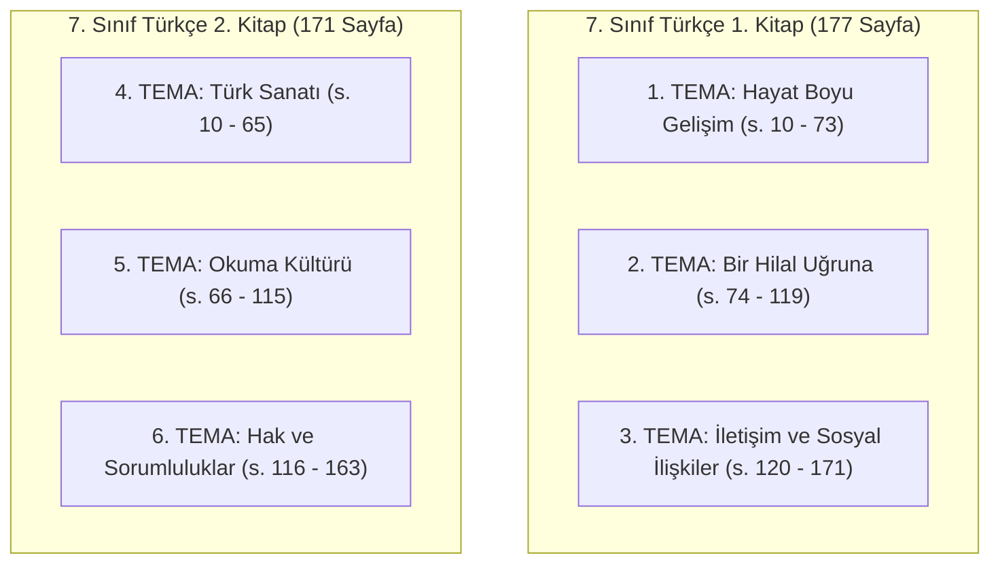
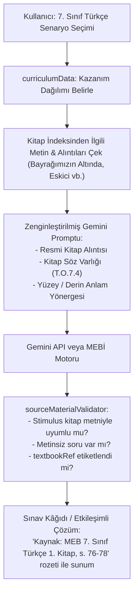
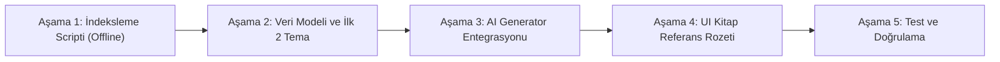

# OYSS 7. Sınıf Türkçe Kitapları Pilot Çalışması: Ön İnceleme ve Teknik Yol Haritası

**Tarih:** 29 Ekim 2026  
**Durum:** Ön İnceleme ve Yol Haritası Tamamlandı (Uygulama Öncesi Kullanıcı Onayı Bekleniyor)  
**Kapsam:** Masaüstündeki MEB ders kitaplarının tespiti, 7. Sınıf Türkçe 1. ve 2. kitaplarının teknik ve pedagojik analizi, OYSS mimarisine entegrasyon için veri modeli, kaynak temelli AI soru üretim akışı ve aşamalı pilot uygulama planı.  
**Önemli Not:** Talimat uyarınca **bu aşamada hiçbir kod değişikliği, dosya taşıma/silme, commit, push veya deploy işlemi yapılmamıştır.**

---

## 1. Masaüstü `Kitaplar` Klasörü Envanter Tespiti

Masaüstünde yer alan `/Users/mesutduran/Desktop/Kitaplar` dizini taranmış ve 7. sınıfa ait toplam 9 adet resmî MEB ders kitabı PDF'i tespit edilmiştir:

| Dosya Adı | Boyut (MB) | Sayfa Sayısı | Durum |
|---|---|---|---|
| `7_Turkce_1_Kitap.pdf` | **73.39 MB** (76.958.254 B) | **177 sayfa** | **1. Pilot Odak Kitabı** |
| `7_Turkce_2_Kitap.pdf` | **67.54 MB** (70.820.860 B) | **171 sayfa** | **2. Pilot Odak Kitabı** |
| `7_Fen_1_Kitap.pdf` | 25.12 MB (26.343.722 B) | 153 sayfa | Sonraki aşama için saklanıyor |
| `7_Fen_2_Kitap.pdf.pdf` *(çift uzantılı)* | 63.09 MB (66.158.722 B) | 166 sayfa | Sonraki aşama için saklanıyor |
| `7_Matematik_1_Kitap.pdf` | 67.46 MB (70.739.503 B) | 224 sayfa | Sonraki aşama için saklanıyor |
| `7_Matematik_2_Kitap.pdf` | 149.08 MB (156.322.756 B) | 216 sayfa | Sonraki aşama için saklanıyor |
| `7_SosyalBilgiler_1_Kitap.pdf` | 107.39 MB (112.602.864 B) | 166 sayfa | Sonraki aşama için saklanıyor |
| `7_SosyalBilgiler_2_Kitap.pdf` | 97.01 MB (101.723.967 B) | 151 sayfa | Sonraki aşama için saklanıyor |
| `7_Din_Kulturu_1_Kitap.pdf` | 39.93 MB (41.873.023 B) | 204 sayfa | Sonraki aşama için saklanıyor |

---

## 2. 7. Sınıf Türkçe Kitaplarının Teknik İncelemesi ve Metin Çıkarılabilirliği

### A. Dosya Kimlik ve Künye Bilgileri
- **Yayın:** Millî Eğitim Bakanlığı Yayınları No: 10823, Ders Kitapları Dizisi No: 2559
- **Resmî Onay:** Millî Eğitim Bakanlığı Talim ve Terbiye Kurulu Başkanlığının **16.07.2026 tarih ve 164480981 sayılı** kararı (Türkiye Yüzyılı Maarif Modeli - TYMM uyumlu güncel baskı)
- **Editör:** Prof. Dr. Yusuf UYAR | **Ölçme ve Değerlendirme Uzmanı:** Yıldız ÖZYÜREK
- **Üretici Yazılım:** Adobe InDesign 21.4 (Macintosh) / Adobe PDF Library 18.0 (Dijital Vektörel Baskı Hazırlık Dosyası)

### B. Metin Çıkarılabilirlik ve Karakter Analizi
Her iki PDF dosyası üzerinde programatik ayrıştırma gerçekleştirilmiştir:
- **1. Kitap (`7_Turkce_1_Kitap.pdf`):**
  - Çıkarılan toplam ham metin karakter sayısı: **247.205 karakter**.
  - Metin içermeyen sayfa sayısı: Yalnızca **1 / 177 sayfa** (o da ön kapak görselidir).
- **2. Kitap (`7_Turkce_2_Kitap.pdf`):**
  - Çıkarılan toplam ham metin karakter sayısı: **248.511 karakter**.
  - Metin içermeyen sayfa sayısı: **0 / 171 sayfa** (istisnasız tüm sayfalar metin içerir).

### C. OCR Gereksinimi Değerlendirmesi
> [!IMPORTANT]
> **KESİN TESPİT: OCR'A HİÇBİR ŞEKİLDE İHTİYAÇ YOKTUR.**  
> Kitaplar taranmış görüntü/resim (raster scan) değil; doğrudan profesyonel dizgi programından (Adobe InDesign) dijital metin katmanıyla ihraç edilmiş vektörel PDF'lerdir.
> Türkçe karakterlerin (ç, ğ, ı, İ, ö, ş, ü), noktalama işaretlerinin, şiir dizelerinin ve çok sütunlu sayfa bloklarının tamamı `pypdf`, `pdfminer` veya `pdfjs` gibi standart kütüphanelerle **%100 doğrulukla ve saniyeler içinde doğrudan metin olarak** çıkarılabilmektedir.

---

## 3. Tema Yapısı, Konular, Öğrenme Çıktıları ve Sayfa Aralıkları

Her iki kitap toplam 6 ana temadan oluşmaktadır:



### 1. Kitap (`7_Turkce_1_Kitap.pdf`):

#### 1. Tema: Hayat Boyu Gelişim (Sayfa 10 - 73)
- **Metinler:**
  1. *Martı Jonathan Livingston* (Richard Bach) (s. 12 - 29) - [Öyküleyici Metin]
  2. *Gençliğin Kıymeti* (s. 30 - 41) - [Bilgilendirici Metin]
  3. *Sen Sor O Yanıtlasın: Sporda ve Yaşamda Hedefe Odaklan* (s. 42 - 50) - [Dinleme/İzleme]
  4. *Adını Göklere Yazdıran Çocuk* (s. 51 - 64) - [Biyografik Öykü]
  5. *Ağaç ve Sen* (s. 67) - [Serbest Okuma Metni]
- **Ölçme ve Değerlendirme:** *1. Tema Ölçme ve Değerlendirme Soruları* (s. 68 - 73)
- **İlişkili Resmî Öğrenme Çıktıları:** Yüzey anlamı belirleyebilme, derin anlamı belirlemeye yönelik çıkarımlar yapabilme, söz varlığı ve tahmin, dinleme ve okuma materyali seçimini yönetebilme.

#### 2. Tema: Bir Hilal Uğruna (Sayfa 74 - 119)
- **Metinler:**
  1. *Bayrağımızın Altında* (Halide Edib Adıvar) (s. 76 - 84) - [Millî Mücadele / Hatice Nine]
  2. *Mustafa 1881-1920 Tarihe Atılan İmza* (s. 85 - 94) - [Tarihî / Biyografik]
  3. *Milli Mücadele Sergisi Kahraman Çocuklar* (s. 95 - 101) - [Dinleme/İzleme]
  4. *Mustafa Kemal’in Kağnısı* (Fazıl Hüsnü Dağlarca) (s. 102 - 111) - [Şiir / Elif'in Kağnısı]
  5. *Gözüm Arkada Kalmayacak* (Ercüment Ekrem Talu) (s. 113 - 114) - [Serbest Okuma Metni / Atatürk ve Çocuk]
- **Ölçme ve Değerlendirme:** *2. Tema Ölçme ve Değerlendirme Soruları* (s. 115 - 119)
- **İlişkili Resmî Öğrenme Çıktıları:** Bilgilendirici metin yapılarından hareketle önemli bilgileri belirleme, görselle iletilen anlam, düşünceyi geliştirme yolları, söz sanatları, çıkarım yapma.

#### 3. Tema: İletişim ve Sosyal İlişkiler (Sayfa 120 - 171)
- **Metinler:**
  1. *Eskici* (Refik Halid Karay) (s. 122 - 133) - [Klasik Hikâye / Hasan ile Eskici]
  2. *Ya Hayır Söyle...* (s. 134 - 143) - [Söyleşi / Nezaket Kuralları]
  3. *Dijital Tayfa - Komik mi Şimdi?* (s. 144 - 155) - [Dinleme/İzleme / Dijital İletişim]
  4. *Öğüt* (s. 156 - 164) - [Şiir]
  5. *Sevgilerde* (Behçet Necatigil) (s. 166) - [Serbest Okuma Metni]
- **Ölçme ve Değerlendirme:** *3. Tema Ölçme ve Değerlendirme Soruları* (s. 167 - 171)
- **İlişkili Resmî Öğrenme Çıktıları:** Metnin bölümlerini belirleme, beden dili ve mekânı etkili kullanabilme, yazılı üretimde karşılaştırma yapabilme, örtük ve derin anlam.

---

### 2. Kitap (`7_Turkce_2_Kitap.pdf`):

#### 4. Tema: Türk Sanatı (Sayfa 10 - 65)
- **Metinler:**
  1. *Anadolu’da Kilim Demek* (Ahmet Kabaklı) (s. 12 - 23) - [Kültür / Kilim Motifleri]
  2. *Geleneksel Türk Tiyatrosu* (s. 24 - 37) - [Geleneksel Tiyatro / Karagöz-Ortaoyunu]
  3. *Ebru: Türk Kâğıt Süsleme Sanatı* (s. 38 - 46) - [Dinleme/İzleme]
  4. *Süleymaniye* (s. 47 - 57) - [Mimar Sinan / Mimari Miras]
  5. *Atatürk ve Sanat Eğitimi* (s. 59) - [Serbest Okuma Metni]
- **Ölçme ve Değerlendirme:** *4. Tema Ölçme ve Değerlendirme Soruları* (Milas Halıları metni vb.) (s. 60 - 65)

#### 5. Tema: Okuma Kültürü (Sayfa 66 - 115)
- **Metinler:**
  1. *Çocuklar Soruyor İlber Hoca Cevaplıyor Gazi Mustafa Kemal Atatürk* (s. 68 - 78) - [Röportaj]
  2. *Kitap* (s. 79 - 89) - [Deneme]
  3. *Küçük Şeylerin Hikâyesi: Kütüphaneler* (s. 90 - 99) - [Dinleme/İzleme]
  4. *Kitaplarla Kurulan Dostluk* (s. 100 - 107) - [Anı/Deneme]
  5. *Canım Kitap* (s. 109) - [Serbest Okuma Metni]
- **Ölçme ve Değerlendirme:** *5. Tema Ölçme ve Değerlendirme Soruları* (s. 110 - 115)

#### 6. Tema: Hak ve Sorumluluklar (Sayfa 116 - 163)
- **Metinler:**
  1. *Kutadgu Bilig* (Yusuf Has Hacib) (s. 118 - 129) - [Klasik Eser / Adalet-Devlet]
  2. *Siyah İnci* (Anna Sewell) (s. 130 - 138) - [Dünya Klasiği / Hayvan Hakları]
  3. *Çocuk Hakları Sözleşmesi* (s. 139 - 147) - [Dinleme/İzleme / Hukuk ve Haklar]
  4. *Üç Soru* (Lev Tolstoy) (s. 148 - 158) - [Felsefi Hikâye]
  5. *Memleket İsterim* (Cahit Sıtkı Tarancı) (s. 160) - [Serbest Okuma Metni]
- **Ölçme ve Değerlendirme:** *6. Tema Ölçme ve Değerlendirme Soruları* (s. 161 - 163)

---

## 4. OYSS Mevcut Mimarisinin Değerlendirilmesi

OYSS kod tabanı incelendiğinde, kitap entegrasyonu için son derece elverişli ve modüler bir zemin bulunduğu görülmüştür:

1. **Soru Veri Yapısı (`src/types/index.ts` - `ExamQuestion`):**
   - Sorularda zaten `stimulus` (kaynak metin/tablo), `contextText` (bağlam), `solutionExplanation`, `archetype` ve son eklediğimiz `sharedSourceId`, `commonStimulus`, `hasMissingSourceError` alanları bulunmaktadır.
   - Buraya tek bir isteğe bağlı alan eklenecektir: `textbookRef?: TextbookReference`.
2. **Kazanım Dağılımı (`src/data/curriculumData.ts`):**
   - 7. Sınıf Türkçe için resmî MEB ÖDSGM senaryoları (`senaryo_1` .. `senaryo_6`) ve kazanım kodları (`T.O.7.4`, `T.O.7.5`, `T.O.7.8`, `T.O.7.21`, `T.Y.7.3`, `T.Y.7.18`, `T.Y.7.21`) mevcuttur.
3. **Soru Havuzu (`src/data/sampleExams.ts`):**
   - `exam_7_turkce_1_1_senaryo_1` .. `senaryo_6` sınavları mevcuttur. İlginç bir biçimde Senaryo 1 sorularında geçen Kastamonu İnebolu ve Şerife Bacı teması, doğrudan Kitap 1 Tema 2 (*Bir Hilal Uğruna*) ruhu ve kazanımlarıyla birebir örtüşmektedir.
4. **Kaynak Doğrulama (`src/utils/sourceMaterialValidator.ts`):**
   - Bir sorunun metne dayanıp dayanmadığını tespit eden, eksik kaynaklı soruları engelleyen ve ortak metinleri bağlayan evrensel bir altyapı zaten çalışmaktadır.
5. **AI Soru Üretim Motoru (`src/utils/aiGeneratorEngine.ts`):**
   - Gemini API çağrısı öncesinde ve Tier 2 havuz seçiminde metinleri normalize edip kalibre eden merkezi bir akış bulunmaktadır.

---

## 5. Önerilen Kitap Kaynak Veri Modeli

Kitaplardaki metinleri, etkinlikleri ve kazanımları hafif, aranabilir ve tip güvenli bir yapıda tutmak için aşağıdaki veri modeli önerilmektedir:

```typescript
// src/types/textbook.ts

export type TextbookGrade = 5 | 6 | 7 | 8;
export type TextbookSubject = 'turkce' | 'matematik' | 'fen' | 'sosyal_bilgiler' | 'din_kulturu';

export interface TextbookPassage {
  id: string;                      // Örn: 'meb_7_turkce_k1_t2_m1'
  bookNumber: 1 | 2;               // 1. Kitap veya 2. Kitap
  themeNumber: number;             // Örn: 2
  themeTitle: string;              // Örn: 'Bir Hilal Uğruna'
  textTitle: string;               // Örn: 'Bayrağımızın Altında'
  author?: string;                 // Örn: 'Halide Edib Adıvar'
  genre: 'oykuleyici' | 'bilgilendirici' | 'siir' | 'dinleme_izleme' | 'serbest_okuma';
  pageRange: {
    textStartPage: number;         // Örn: 76
    textEndPage: number;           // Örn: 78
    activityStartPage?: number;    // Örn: 79
    activityEndPage?: number;      // Örn: 84
  };
  summary: string;                 // Metnin 2-3 cümlelik özeti
  fullText: string;                // Soru stimulus'u olarak kullanılabilecek temiz, biçimlendirilmiş tam metin
  extractablePassages: {           // Sınav kâğıdı boyutuna uygun (150-400 kelimelik) alıntılar
    id: string;
    title: string;
    excerpt: string;
    wordCount: number;
  }[];
  keyVocabulary: {                 // 1. Etkinlik söz varlığı unsurları (T.O.7.4 ve T.O.7.21 için)
    word: string;
    meaningInContext: string;
    isIdiomOrProverb?: boolean;
  }[];
  associatedOutcomes: string[];    // Örn: ['T.O.7.4', 'T.O.7.5', 'T.O.7.8', 'T.O.7.21']
  characterList?: string[];        // Örn: ['Hatice Nine', 'Yazar (Anlatıcı)', 'Salihli halkı']
  themesAndValues: string[];       // Örn: ['Vatan sevgisi', 'Bağımsızlık', 'Fedakârlık']
}

export interface TextbookMetadata {
  id: string;                      // 'meb_7_turkce_2026'
  title: string;                   // '7. Sınıf Türkçe Ders Kitabı'
  edition: string;                 // 'MEB Yayınları No: 10823, TTKB 16.07.2026 / 164480981'
  academicYear: '2026-2027';
  grade: 7;
  subject: 'turkce';
  volumesCount: 2;
  passages: TextbookPassage[];
}

// ExamQuestion modeline eklenecek alan:
export interface TextbookReference {
  bookTitle: string;               // '7. Sınıf Türkçe 1. Kitap'
  themeTitle: string;              // '2. Tema: Bir Hilal Uğruna'
  textTitle: string;               // 'Bayrağımızın Altında'
  author?: string;                 // 'Halide Edib Adıvar'
  pageNumber: number;              // 76
  citationBadge: string;           // 'MEB 7. Sınıf Türkçe 1. Kitap, s. 76-78'
}
```

---

## 6. AI Soru Üretiminde Kitap İçeriğinin Kullanım Stratejisi



### A. Sorunun Kitaptaki Bölüme Dayandırılması ve Doğrulama
- AI sorusu rastgele uydurma kurgular yerine, öğrencinin derste gördüğü gerçek metinler üzerinden üretilir.
- Soru kâğıdında ve etkileşimli ekranda soru başlığının hemen yanında zarif bir kaynak rozeti gösterilir:
  `[📚 MEB 7. Sınıf Türkçe 1. Kitap, s. 76-78 (Halide Edib Adıvar - Bayrağımızın Altında)]`

### B. Eksik Kaynak Materyal Riskinin Sıfırlanması
- Önceki aşamada tespit ettiğimiz "Zeytin hasadı metninin kaybolması" türündeki hatalar bu sayede kökten çözülür; çünkü yapay zekâya *"kendin bir metin hayal et"* denmek yerine, kitap indeksindeki onaylı metin doğrudan `stimulus` alanına aktarılır.

### C. Bilgi Doğruluğu ve Olgusal Çarpıtmaların Engellenmesi
- Edebi metinlerin karakter isimleri (Jonathan Livingston, Hatice Nine, Elifçik, Hasan, Eskici), mekânlar ve olay örgüsü doğrudan MEB onaylı kitapla %100 uyumlu kalır; halüsinasyon riski ortadan kalkar.

### D. Yüzey Anlam vs. Derin Anlam Ayrımının Pedagojik Olarak Kurulması
Kitapların tema girişlerinde açıkça belirtilen TYMM hedeflerine uygun olarak soru tipleri ayrıştırılır:
1. **Yüzey Anlam (`T.O.7.5` - Aynen yazan):** Metinde açıkça ifade edilen olay sırası, mekân, kişi özellikleri ve doğrudan bilgiler (Örn: *"Hatice Nine hayatı boyunca kaç kez muhacir olmuştur?"* -> Metinde doğrudan *"beş defa"* yazar).
2. **Derin Anlam (`T.O.7.8` - Çıkarım gerektiren):** Metinde satır aralarında gizli olan, yazarın amacını, ana fikri, örtük mesajı veya karakterin psikolojisini tahlil eden sorular (Örn: *"Hatice Nine'nin diğer kadınlara göre daha huzurlu olmasının ve muradına ermiş hissetmesinin sebebi nedir?"* -> Metinden hareketle bağımsızlık ve hürriyet çıkarımı).
3. **Söz Varlığı (`T.O.7.4` / `T.O.7.21`):** Kitabın 1. Etkinliklerinde yer alan hedef kelimeler ve mecaz anlamlar bağlamında sorular.

---

## 7. Depolama ve Dağıtım Mimarisi Değerlendirmesi

| Yöntem | Açıklama | Avantajlar | Dezavantajlar | Karar |
|---|---|---|---|---|
| **Yöntem 1: PDF Dosyalarını JS Bundle'ına Gömmek** | 70-76 MB'lık ham PDF dosyalarını doğrudan React paketine dâhil etmek. | Yok | Paket boyutu **150+ MB** olur; mobil tarayıcılar çöker, yükleme dakikalar sürer. | **KESİNLİKLE REDDEDİLDİ** |
| **Yöntem 2: Önceden Çıkarılmış Yapılandırılmış JSON/TS İndeksi** *(Önerilen)* | PDF'lerden sadece metinler, anahtar kelimeler ve meta-verilerin çıkarılıp sıkıştırılmış TypeScript/JSON dosyası olarak derlenmesi (`src/data/textbooks/`). | - Boyut yalnızca **~80-120 KB** (Gzip ile ~25 KB).<br>- Sıfır ağ gecikmesi.<br>- Tamamen offline ve SingleFile uyumlu.<br>- Tip güvenli ve anında arama yapılabilir. | Kitap güncellenirse derleme öncesi JSON dosyasının yenilenmesi gerekir (zaten kitaplar yılda bir güncellenir). | **EN GÜÇLÜ VE UYGUN ÇÖZÜM (ÖNERİLEN)** |
| **Yöntem 3: Statik JSON Dosyasını CDN'den On-Demand Fetch ile Çekmek** | İndeksin `/textbooks/7_turkce.json` olarak `public/` altına konup sadece 7. sınıf Türkçe seçildiğinde `fetch()` ile yüklenmesi. | Ana uygulama paketini 1 KB bile büyütmez; sadece ilgili sınıf seçildiğinde yüklenir. | İnternetsiz veya statik tek dosya (`dist/index.html`) offline açılışlarında yerel ağ isteği gerektirebilir. | İleride tüm sınıflar ve dersler (50+ kitap) eklendiğinde değerlendirilebilir |
| **Yöntem 4: Sunucu Tarafı Vektör Veritabanı / RAG (Retrieval-Augmented Generation)** | Metinleri sunucuda Pinecone/pgvector ve LangChain ile vektörel aratmak. | Çok büyük metin kütüphanelerinde anlamsal parça arama gücü sağlar. | Yüksek altyapı maliyeti, API bağımlılığı, gecikme (latency), karmaşık mimari. Küçük bir pilot için aşırı mühendislik. | İleri aşamalarda opsiyonel |

---

## 8. Aşamalı Pilot Uygulama Planı (7. Sınıf Türkçe)



### Aşama 1: Çevrimdışı İndeksleme ve Ayıklama Aracı
- Proje kaynak kodlarına dokunmadan bir geliştirici yardımcısı betik (`scripts/extractTextbookPassages.py`) oluşturulur.
- 1. Kitap'tan 1. ve 2. Temaların (örneğin *Martı Jonathan Livingston*, *Bayrağımızın Altında*, *Mustafa Kemal'in Kağnısı*) metinleri, söz varlığı ve etkinlik soruları taranıp temiz JSON formatına dönüştürülür.

### Aşama 2: Veri Modeli ve Pilot İndeks Dosyası
- `src/types/textbook.ts` tipi tanımlanır.
- `src/data/textbooks/grade7Turkce.ts` dosyası oluşturularak ilk 4 metin eksiksiz şekilde projeye kazandırılır.

### Aşama 3: AI Motoru ve Soru Havuzu Bağlantısı
- `aiGeneratorEngine.ts`: 7. Sınıf Türkçe için soru üretilirken prompt, kitap indeksindeki gerçek metin parçacığıyla beslenir.
- `sourceMaterialValidator.ts`: Kitap referansı olan sorular otomatik onaylanır ve eksik metin kontrollerinden tam geçer.

### Aşama 4: A4 Sınav Kâğıdı ve Etkileşimli Ekranda Kaynak Gösterimi
- Soru başlığında: `[📚 MEB 7. Sınıf Türkçe Ders Kitabı (1. Kitap, s. 76-78)]` rozeti eklenir.
- Öğrenci etkileşimli çözerken veya öğretmen kâğıdı yazdırırken sorunun kitabın hangi teması ve sayfasına dayandığını tek bakışta görür.

### Aşama 5: Kapsamlı Test ve Doğrulama
- 7. Sınıf Türkçe soru üretimleri ve sınav çözümleri otomatik testlerle denetlenir.

---

## 9. Test Senaryoları ve Başarı Ölçütleri (KPI'lar)

### Önerilen Test Senaryoları:
1. **Kitap Metni Bütünlüğü Testi:** Çıkarılan metinlerin orijinal PDF içeriğiyle kelimesi kelimesine (%100) eşleştiği ve Türkçe karakter bozulması (mojibake) yaşanmadığı doğrulanır.
2. **Kazanım-Metin Eşleşme Testi:** `T.O.7.5` (Yüzey Anlam) için üretilen sorunun cevabının metinde açıkça yer aldığı; `T.O.7.8` (Derin Anlam) sorusunun ise metinden çıkarım gerektirdiği doğrulanır.
3. **Eksik Kaynak Koruması Testi:** Kitaptan beslenen sorularda `stimulus` alanının asla boş kalmadığı ve `hasMissingSourceError` üretilmediği doğrulanır.
4. **Bundle Boyutu Testi:** Yapılandırılmış indeks eklendikten sonra üretim derlemesinin (`dist/index.html`) boyut artışının 150 KB'ı geçmediği doğrulanır.
5. **A4 Yazdırma ve Etkileşimli Çözüm Testi:** Kitap referans rozetinin A4 yazdırmada ve ekranda düzgün biçimlendiği doğrulanır.
6. **Gerileme (Regression) Testi:** 5., 6. ve 8. sınıflar, matematik düzenleyicisi ve mevcut 51 testin tamamının yeşil kalmaya devam ettiği doğrulanır.

### Başarı Ölçütleri:
- Yapay zekâ tarafından 7. Sınıf Türkçe için üretilen sınavların **%100'ünün MEB ders kitabındaki onaylı metinlere dayanması**.
- Soru köklerinde uydurma/halüsinasyon karakter ve olay riskinin **%0'a indirilmesi**.
- Sayfa yükleme hızında ve derleme süresinde **kayda değer bir yavaşlama olmaması**.

---

## 10. Sonuç ve Onay Bildirimi

Bu inceleme, masaüstündeki 7. sınıf Türkçe ders kitaplarının mükemmel dijital kalitede olduğunu, OCR gerektirmediğini ve OYSS'nin mevcut mimarisine hafif ve ölçeklenebilir bir JSON indeksi aracılığıyla sorunsuz biçimde entegre edilebileceğini ortaya koymuştur.

> [!IMPORTANT]
> **Mevcut durum:** Hiçbir kaynak dosya değiştirilmemiş, taşınmamış veya silinmemiştir.  
> Bu teknik yol haritasını ve önerilen veri modelini onaylamanız durumunda, 1. Aşama olan pilot metinlerin çıkarılması ve indekslenmesi adımına geçilecektir.
