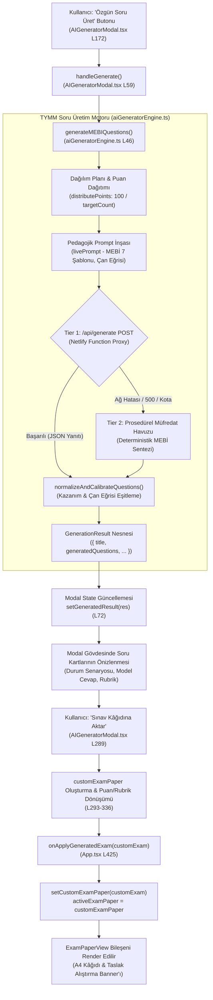
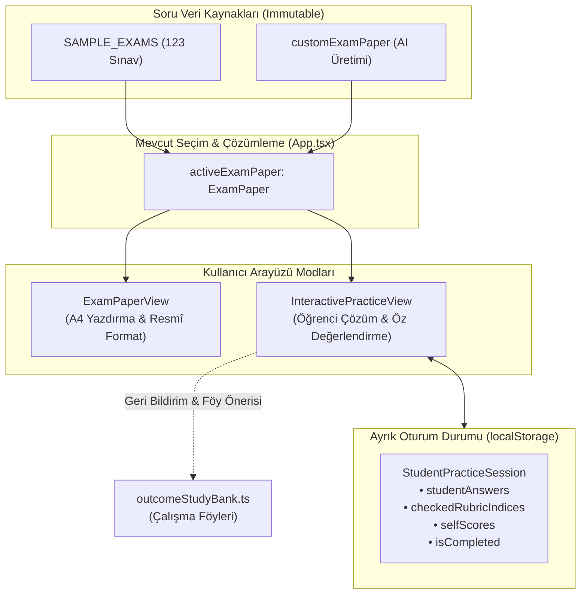

# OYSS: Mevcut Yapay Zekâ Soru Üretim Motoru ve Sınav Aktarım Akışı Teknik İnceleme Raporu

**Tarih:** 29 Ekim 2026  
**İnceleme Kapsamı:** TYMM Soru & Materyal Üretim Motoru (`aiGeneratorEngine.ts`), Modal Arayüzü (`AIGeneratorModal.tsx`), Sınav Kâğıdına Aktarım Akışı (`App.tsx` & `ExamPaperView.tsx`) ve Açık Uçlu Etkileşimli Çözüm Modülü Uygunluğu  
**Teknik ve Yasal Sınır:** Bu aşamada **hiçbir kaynak kodu değiştirilmemiş**, sınav ve müfredat verilerine dokunulmamış, yeni paket yüklenmemiş, Git commit/push yapılmamış ve canlı siteye dağıtım tetiklenmemiştir. Yalnızca statik kod analizi, veri akışı takibi ve algoritmik doğrulama yürütülmüştür.

---

## 1. Yönetici Özeti

Bu teknik inceleme, OYSS bünyesinde çalışan **TYMM Soru ve Materyal Üretim Motoru**'nun iç mekanizmasını, üretilen açık uçlu soruların ana sınav ekranına aktarılma biçimini ve bu soruların ileride geliştirilecek etkileşimli sınav çözüm (öz değerlendirme) modülünde hazır sınavlarla birlikte kullanılıp kullanılamayacağını tespit etmek amacıyla gerçekleştirilmiştir.

### Temel Bulgular Özeti

1. **Çift Kademeli Üretim Mimarisi (Tier 1 & Tier 2):**  
   Motor iki katmanlı olarak tasarlanmıştır. Birinci kademede istemciden API anahtarı taşımaksızın doğrudan güvenli sunucu fonksiyonuna ([`netlify/functions/generate.ts`](file:///Users/mesutduran/Desktop/OYSS/netlify/functions/generate.ts)) istek atılır ve Google Gemini modelinden MEB ÖDSGM senaryosuna göre yapılandırılmış JSON çıktısı alınır. Ağ kopması, API hatası veya kota aşımında sistem kesintiye uğramamakta; ikinci kademede yer alan deterministik prosedürel MEBİ motoru ([`src/utils/aiGeneratorEngine.ts`](file:///Users/mesutduran/Desktop/OYSS/src/utils/aiGeneratorEngine.ts)) devreye girmektedir.

2. **Ders Değişiminde Eski Üretimin Ekranda Kalması Sorunu:**  
   [`src/components/AIGeneratorModal.tsx`](file:///Users/mesutduran/Desktop/OYSS/src/components/AIGeneratorModal.tsx) bileşeni, ana uygulama ([`src/App.tsx`](file:///Users/mesutduran/Desktop/OYSS/src/App.tsx)) içinde kalıcı olarak mount durumdadır. Üretim sonucu bileşenin yerel `generatedResult` state'inde saklanmaktadır. Bileşende `grade` veya `subjectId` değiştiğinde bu state'i sıfırlayan (`setGeneratedResult(null)`) hiçbir `useEffect` kancası bulunmamaktadır. Bu durum bilinçli bir çoklu ders önbelleği değil, **state sıfırlama/senkronizasyon eksikliğidir**. Kullanıcı 5. Sınıf Türkçe'de soru üretip pencereyi kapattıktan sonra 7. Sınıf Fen Bilimleri'ne geçip modalı tekrar açtığında, modal başlığı 7. Sınıf Fen Bilimleri yazdığı halde kartlarda 5. Sınıf Türkçe soruları görünmekte; kullanıcı "Sınav Kâğıdına Aktar" dediğinde Türkçe soruları 7. Sınıf Fen sınavı olarak ana ekrana aktarılabilmektedir.

3. **Puan ve Rubrik Tutarsızlığı (Kesin Hata Tespiti):**  
   Ekran görüntülerinde şüphelenilen uyuşmazlık kaynak kod üzerinden matematiksel olarak kanıtlanmıştır. [`src/components/AIGeneratorModal.tsx`](file:///Users/mesutduran/Desktop/OYSS/src/components/AIGeneratorModal.tsx) satır 311'de yer alan:
   $$\text{pts} = \text{Math.round}\left(\frac{\text{r.pts}}{\text{rawRubricSum}} \times \text{questionPts}\right)$$
   formülünde her rubrik maddesi bağımsız olarak yuvarlandığı ve yuvarlama artığı (remainder) hesaba katılmadığı için, tek puanlı sorularda veya eşit paylaştırılmayan ölçütlerde **rubrik ölçütleri toplamı soru puanına eşit çıkmamaktadır** ($\sum \text{rubrik} \neq \text{soru puanı}$). Örneğin 17 puanlık bir soruda iki eşit kriter $8 + 8 = 16$ puan (-1 puan eksik), 15 puanlık soruda iki eşit kriter $8 + 8 = 16$ puan (+1 puan fazla) üretmektedir. Ayrıca sistemde üretim veya aktarım sonrası bu uyuşmazlığı tespit eden hiçbir doğrulama (validation) fonksiyonu bulunmamaktadır.

4. **Etkileşimli Çözüm Modülü Uygunluğu:**  
   Hem mevcut 123 hazır sınav ([`src/data/sampleExams.ts`](file:///Users/mesutduran/Desktop/OYSS/src/data/sampleExams.ts)) hem de yapay zekâ motorunun kâğıda aktardığı taslak sınav (`customExamPaper`), birebir aynı [`ExamPaper`](file:///Users/mesutduran/Desktop/OYSS/src/types/index.ts#L86-L98) arayüzünü paylaşmaktadır. Dolayısıyla ileride geliştirilecek açık uçlu etkileşimli sınav çözüm bileşeni, her iki soru kaynağını hiçbir veri dönüşümü gerekmeden tek bir arayüzde tüketebilir.

---

## 2. İncelenen Kaynak Dosyalar

| Dosya Yolu | Satır Sayısı | Sistemdeki Görevi |
| :--- | :---: | :--- |
| [`src/components/AIGeneratorModal.tsx`](file:///Users/mesutduran/Desktop/OYSS/src/components/AIGeneratorModal.tsx) | 377 | TYMM soru üretim modalı arayüzü, kullanıcı tercihleri, soru kartlarının listelenmesi ve "Sınav Kâğıdına Aktar" dönüşüm akışı. |
| [`src/utils/aiGeneratorEngine.ts`](file:///Users/mesutduran/Desktop/OYSS/src/utils/aiGeneratorEngine.ts) | 1.469 | Ana soru üretim motoru: Tier 1 Netlify Function istemi, prompt inşası, Tier 2 prosedürel MEBİ soru havuzu ve dinamik şablon sentezi. |
| [`netlify/functions/generate.ts`](file:///Users/mesutduran/Desktop/OYSS/netlify/functions/generate.ts) | 260 | Sunucu tarafı güvenli Gemini API proxy uç noktası; model zinciri (`gemini-2.5-flash`), origin ve metod denetimi. |
| [`src/App.tsx`](file:///Users/mesutduran/Desktop/OYSS/src/App.tsx) | 447 | Ana uygulama kabuğu; `customExamPaper` state yönetimi, `activeExamPaper` çözümlemesi ve modal tetikleyicileri. |
| [`src/components/ExamPaperView.tsx`](file:///Users/mesutduran/Desktop/OYSS/src/components/ExamPaperView.tsx) | 369 | Resmî formatlı A4 ortak sınav kâğıdı görünümü, yazdırma kontrolleri ve özel yapay zekâ sınavı banner'ı. |
| [`src/utils/difficultyCalibrator.ts`](file:///Users/mesutduran/Desktop/OYSS/src/utils/difficultyCalibrator.ts) | 102 | Soruların zorluk derecelerini MEB ÖDSGM normal dağılım (çan eğrisi) standartlarına göre yeniden kalibre eden yardımcı motor. |
| [`src/types/index.ts`](file:///Users/mesutduran/Desktop/OYSS/src/types/index.ts) | 150 | `ExamPaper`, `ExamQuestion`, `QuestionRubricItem` ve `GenerationResult` ortak veri modelleri. |

---

## 3. Üretim Motorunun Çalışma Akışı

Aşağıdaki şemada kullanıcının butona tıklamasından sınav kâğıdına aktarım anına kadar geçen teknik veri akışı gösterilmektedir:



### 3.1. Parametrelerin Aktarımı ve Prompt İnşası

- **Girdi Parametreleri:** `AIGeneratorModalProps` üzerinden gelen `grade` (sınıf düzeyi), `subjectId` (ders kodu), `examTerm` (dönem/yazılı) ve `scenario` (ÖDSGM senaryo nesnesi) `generateMEBIQuestions` fonksiyonuna aktarılır.
- **Kazanım Dağılımının Çözümlenmesi:** `scenario.distributions` dizisindeki soru sayıları açılarak (`expandedDistributions`) hedef soru listesi (`questionDistributions`) oluşturulur.
- **Puanlama Dağıtımı (`distributePoints` - Satır 39–44):**
  ```ts
  function distributePoints(count: number): number[] {
    if (count <= 0) return [];
    const base = Math.floor(100 / count);
    const remainder = 100 % count;
    return Array.from({ length: count }, (_, i) => base + (i < remainder ? 1 : 0));
  }
  ```
  Bu fonksiyon toplam 100 puanı soru sayısına göre dağıtır. Örneğin 6 soru için `[17, 17, 17, 17, 16, 16]` puan dizisi üretilir ($\sum = 100$).
- **`livePrompt` Yapılandırması (Satır 83–155):**
  Prompt metninde şu pedagojik kurallar modele kesin talimat olarak verilir:
  1. *Zorunlu Kazanım Eşleşmesi:* Her soru senaryo dağılımındaki resmi öğrenme çıktısıyla birebir eşleşmelidir.
  2. *Dil ve Seviye Uyumu:* 12-13 yaş grubu düzeyine uygun, ağır akademik jargon içermeyen duru Türkçe.
  3. *ÖDSGM Pedagojik Çan Eğrisi:* `difficultyPlanText` ile hesaplanan kolay-orta-zor dengesi (%20-25 Kolay, %50-60 Orta, %15-20 Zor).
  4. *Bağlam Çeşitliliği:* Soruların aynı mekânda (örneğin yalnızca okul veya laboratuvar) geçmemesi; ev ekonomisi, doğa, atölye, spor gibi farklı gerçek yaşam durumlarına yayılması.
  5. *MEBİ 7 Açık Uçlu Soru Şablonu:* Düz ezber tanımlar yasaklanarak; Durum/Özellik Matrisi, Öğrenci Diyaloğu & Yanılgı Tespiti, Hata Tespiti & Adım Analizi, vb. şablonlar zorunlu tutulmuştur.

### 3.2. Soru Sayısı Belirleme ve Çıktı Kontrolü

- `AIGeneratorModal.tsx` satır 43'te `questionCountChoice` state'i `scenario.totalQuestions || 6` ile başlatılır. Satır 46-50'deki `useEffect` senaryo değiştiğinde bu değeri günceller.
- Kullanıcı modal arayüzündeki açılır menüden soru sayısını (Senaryo Standardı, 5, 6, 7 veya 3) seçebilir.
- **Üretim Sonrası Sayı Kontrolü:** Modelden dönen liste `normalizeAndCalibrateQuestions` fonksiyonunda `questions.slice(0, targetCount)` ifadesiyle kırpılır (satır 158). Model gerekenden fazla soru üretmişse fazlalık atılır; ancak model eksik soru üretirse (örn. 6 yerine 4), mevcut kod eksik kalan soruları otomatik tamamlamamaktadır. Tier 2 prosedürel motorda ise `targetCount` kadar soru döngüyle kesin olarak üretilir.

### 3.3. Hata Yönetimi ve Yedek Motor (Fallback)

- `/api/generate` çağrısı başarısız olursa (ağ kopması, API kotası, geçersiz JSON), kod `try...catch` bloğu ile hatayı yakalar (`aiGeneratorEngine.ts` satır 214–216) ve programı çökertmeden doğrudan **Tier 2 Prosedürel Müfredat Motoru**'na geçer.
- Prosedürel motor, önceden tanımlanmış zengin MEBİ soru şablonlarını ve ders havuzlarını kullanarak deterministik olarak `GenerationResult` üretir ve kullanıcıya kesintisiz biçimde sunar.

---

## 4. Ders Değiştirme ve Eski Sonuçların Gösterimi

### 4.1. Sorunun Kaynak Koddaki Mekanizması

Kullanıcının karşılaştığı durum: Bir derste (örneğin 5. Sınıf Türkçe) yapay zekâ soruları üretildikten sonra başka bir derse (örneğin 7. Sınıf Fen Bilimleri) geçilip üretim penceresi açıldığında, yeni üretim yapılana kadar Türkçe sorularının ekranda kalmasıdır.

Bu durum kaynak kod üzerinden incelendiğinde şu somut tespitler yapılmıştır:

1. **Bileşenin Mount Durumu:**  
   [`src/App.tsx`](file:///Users/mesutduran/Desktop/OYSS/src/App.tsx) satır 418–432'de `AIGeneratorModal` bileşeni şu şekilde çağrılmaktadır:
   ```tsx
   <AIGeneratorModal
     isOpen={isAIModalOpen}
     onClose={() => setIsAIModalOpen(false)}
     grade={selectedGrade}
     subjectId={selectedSubject}
     examTerm={selectedTerm}
     scenario={currentScenario}
     onApplyGeneratedExam={...}
   />
   ```
   Bileşene React tarafından `key` prop'u atanmamıştır ve `{isAIModalOpen && <AIGeneratorModal ... />}` şeklinde koşullu mount edilmemektedir.
2. **Erken Dönüşün (Early Return) State'e Etkisi:**  
   [`src/components/AIGeneratorModal.tsx`](file:///Users/mesutduran/Desktop/OYSS/src/components/AIGeneratorModal.tsx) satır 55'te:
   ```tsx
   if (!isOpen) return null;
   ```
   kontrolü bulunmaktadır. React mimarisinde bir fonksiyonel bileşenin `null` dönmesi o bileşeni unmount **etmez**; sanal DOM ağacında bileşen örneği (fiber) ve hook state'leri bellekte korunur.
3. **State Sıfırlama Kancasının (useEffect) Eksikliği:**  
   Bileşende satır 52'de tanımlanan `generatedResult`:
   ```tsx
   const [generatedResult, setGeneratedResult] = useState<GenerationResult | null>(null);
   ```
   yalnızca `handleGenerate` başarılı olduğunda `setGeneratedResult(res)` ile güncellenmektedir. Bileşenin tüm kodu boyunca **`setGeneratedResult(null)` çağrısı yapan tek bir satır dahi bulunmamaktadır**.
   Satır 46-50 arasındaki tek `useEffect` ise yalnızca `scenario.totalQuestions` değiştiğinde soru sayısı seçimini güncellemektedir:
   ```tsx
   useEffect(() => {
     if (scenario?.totalQuestions) {
       setQuestionCountChoice(scenario.totalQuestions);
     }
   }, [scenario?.id, scenario?.totalQuestions]);
   ```
   Burada `grade` veya `subjectId` bağımlılıkları izlenmemektedir ve `generatedResult` sıfırlanmamaktadır.

### 4.2. Tasarım Değerlendirmesi: Bilinçli Önbellek mi, State Sıfırlama Eksikliği mi?

| Değerlendirme Ölçütü | Kodun Gösterdiği Gerçek | Tasarım Yorumu |
| :--- | :--- | :--- |
| **Ders Bazlı Önbellek Yapısı Var mı?** | Hayır. `generatedResult` tek bir nesnedir (`GenerationResult \| null`). Sözlük (`Record<SubjectId, ...>`) veya harita yapısı yoktur. | Kodda çoklu dersi hafızada tutmaya yönelik bilinçli bir mimari kurgulanmamıştır. |
| **Kullanıcı Arayüzü Uyarısı Var mı?** | Hayır. Modal başlığı güncel props'tan beslenerek *"7. Sınıf Fen Bilimleri"* yazmakta; altındaki kartlar ise eski 5. Sınıf Türkçe sorularını göstermektedir. | Kullanıcı arayüzünde çok ciddi bir algı ve bağlam çatışması (mismatch) oluşmaktadır. |
| **Aktarım Butonunun Davranışı:** | "Sınav Kâğıdına Aktar" tıklandığında `customExam.grade = grade` (7) ve `customExam.subjectId = subjectId` ('fen_bilimleri') atanırken, soru metinleri Türkçe kalmaktadır. | Bu durum, kullanıcının yanlışlıkla başka bir dersin sorularını yeni derse aitmiş gibi sınav kâğıdı yapmasına yol açabilecek kritik bir veri tutarsızlığıdır. |

**Sonuç:** Bu davranış kesinlikle bilinçli bir çoklu ders önbellek tasarımı değildir; **React yaşam döngüsünde props değişimine bağlı state sıfırlama (state synchronization) kuralının unutulmasından kaynaklanan bir eksikliktir**.

### 4.3. Önerilen Güvenli Tasarım

Üretim tamamlanana kadar önceki sonuçları saklamak yalnızca **aynı ders ve senaryo içinde** anlamlıdır. Kullanıcı sınıf, ders veya senaryo değiştirdiğinde önceki sonuçların ekranda kalması tehlikelidir ve derhal temizlenmelidir.

- **Önerilen En Sade Çözüm:** `AIGeneratorModal.tsx` içine aşağıdaki yaşam döngüsü kuralının eklenmesi:
  ```tsx
  useEffect(() => {
    setGeneratedResult(null);
  }, [grade, subjectId, scenario?.id]);
  ```
  veya `App.tsx` çağrımında `key={`${selectedGrade}_${selectedSubject}_${selectedScenarioId}`}` kullanılarak ders değişiminde modal state'inin temiz başlatılmasıdır.

---

## 5. “Sınav Kâğıdına Aktar” Akışının Alan Bazında Analizi

Kullanıcı modalın altındaki **“Sınav Kağıdına Aktar”** butonuna ([`src/components/AIGeneratorModal.tsx`](file:///Users/mesutduran/Desktop/OYSS/src/components/AIGeneratorModal.tsx) satır 289–345) bastığında gerçekleşen işlemler:

### 5.1. Akış Adımları

1. **Soru Başına Taban Puan Hesabı (Satır 290–291):**  
   `qCount = generatedResult.generatedQuestions.length`  
   `qPoints = qCount > 0 ? Math.round(100 / qCount) : 50`
2. **Sınav Üst Verisinin Oluşturulması (Satır 293–306):**  
   `id`: `ai_generated_${Date.now()}` şeklinde milisaniye zaman damgasıyla tekil bir ID üretilir.  
   `title`: `${grade}. Sınıf ${subjectMeta?.name} (${scenario.name}) - Özgün Çalışma ve Alıştırma Seti (#${generatedResult.variationNumber})`  
   `durationMinutes`: 40  
   `totalPoints`: 100  
   `instructions`: MEBİ pedagojik yönerge metinleri dizisi.
3. **Soruların Dönüştürülmesi (`generatedQuestions.map` - Satır 307–334):**  
   Üretilen soru nesneleri `ExamQuestion` şemasına haritalanır.
4. **Zorluk Kalibrasyonu (Satır 337):**  
   `calibrateQuestionDifficulties(customExam.questions)` çağrılarak soruların MEB çan eğrisi zorluk dağılımı teyit edilir.
5. **Uygulamaya Teslim ve Kapatma (Satır 338–339):**  
   `onApplyGeneratedExam({ ...customExam, questions: calibratedQuestions })` tetiklenir ve `onClose()` çağrılır.
6. **Ana Uygulama Entegrasyonu ([`src/App.tsx`](file:///Users/mesutduran/Desktop/OYSS/src/App.tsx) Satır 425–431):**  
   `setCustomExamPaper(customExam)` çalıştırılır, `selectedMaterial = 'exam_paper'` yapılır ve sayfa sınav kâğıdı alanına yumuşak kaydırılır (`window.scrollTo`).
7. **Aktif Sınavın Seçilmesi ([`src/App.tsx`](file:///Users/mesutduran/Desktop/OYSS/src/App.tsx) Satır 133–136):**  
   `activeExamPaper` çözümleyicisi, `customExamPaper` seçili sınıf ve derse uyuyorsa hazır arşivi atlayarak doğrudan yapay zekâ sınavını [`src/components/ExamPaperView.tsx`](file:///Users/mesutduran/Desktop/OYSS/src/components/ExamPaperView.tsx) bileşenine iletir.

### 5.2. Nesne Alanlarının Karşılaştırma Matrisi

Aşağıdaki tablo, soru motorundan çıkan `GeneratedQuestionItem` ile sınav kâğıdındaki `ExamQuestion` nesnesinin alan bazında tam eşleşmesini göstermektedir:

| Kaynak Alan (`GeneratedQuestionItem`) | Hedef Alan (`ExamQuestion`) | Aktarım Durumu | Açıklama ve Bulgular |
| :--- | :--- | :---: | :--- |
| `q.number` | `questionNumber` | **Tam Korunuyor** | Soru numarası (1, 2, 3...) doğrudan aktarılır. |
| `q.outcome` | `outcomeCode` | **Tam Korunuyor** | MEB kazanım kodu (örn. `FB.7.1.1`) korunur. |
| `q.outcomeTitle` | `outcomeTitle` | **Zenginleştiriliyor** | `getOfficialOutcomeTitle(q.outcome)` ile resmi müfredat başlığı aranır; yoksa şablon başlığı atanır. |
| `q.difficulty` | `difficulty` | **Yeniden Kalibre Ediliyor** | `q.difficulty \|\| 'Orta'` alınır, ardından `calibrateQuestionDifficulties` ile çan eğrisine oturtulur. |
| `q.level` | `cognitiveLevel` | **Tam Korunuyor** | `q.level \|\| 'Karmaşık Bilişsel Süreçler'` atanır. |
| `q.templateType` | `archetype` | **Tam Korunuyor** | MEBİ soru şablonu (örn. `Öğrenci Diyaloğu & Kavram Yanılgısı`) atanır. |
| `q.points` | `points` | **Koşullu Hesaplanıyor** | `q.points \|\| qPoints` formülüyle soru puanı belirlenir. |
| `q.stimulus` | `stimulus` | **Tam Korunuyor** | Deney düzeneği, öğrenci diyaloğu veya vaka metni eksiksiz korunur. |
| `q.question` | `questionText` | **Tam Korunuyor** | Açık uçlu soru kökü korunur. |
| `q.answer` | `modelAnswer` | **Tam Korunuyor** | Model cevap ve çözüm basamakları korunur. |
| *(Motordan gelen açıklama)* | `solutionExplanation` | **Sabit Metinle Eziliyor** | **Kritik Tespit:** Soruya özel üretilmiş bir açıklama varsa dahi aktarımda atılmakta; yerine `'MEBİ kuralına uygun analitik çözüm ve dereceli puanlama.'` şeklinde sabit genel bir string yazılmaktadır. |
| `q.rubric` | `rubric` | **Dönüştürülüyor (Hatalı)** | **Kritik Tespit:** `rawRubricSum` üzerinden orantılama yapılırken bağımsız `Math.round` uygulandığı için yuvarlama artığı kaybolmakta ve kriter toplamları soru puanından sapmaktadır. |
| *(Yok)* | `contextText` | **Boş Bırakılıyor** | Aktarım kodunda `contextText` alanına atama yapılmamaktadır (`undefined` kalır). |

### 5.3. Düzenleme ve Yazdırma Kabiliyetleri

- **Yazdırma Kabiliyeti:** Kullanıcı aktarım sonrasında sınav kâğıdını [`src/components/ExamPaperView.tsx`](file:///Users/mesutduran/Desktop/OYSS/src/components/ExamPaperView.tsx) üzerinden eksiksiz yazdırabilir (`window.print()`). Kâğıt üzerinde cevap satır sayısı (2, 3, 4 satır), kazanım başlığını baskıda gizleme/gösterme, rubrik gösterme/gizleme ve "Özgün Çalışma ve Alıştırma Seti (Taslak)" uyarı rozeti sorunsuz çalışmaktadır.
- **Düzenleme Kabiliyeti:** Kullanıcı aktarılan sınav kâğıdı üzerinde **metin düzenlemesi (inline edit) yapamamaktadır**. Soru metinleri, puanlar veya rubrik maddeleri salt okunur (read-only) bileşenlerle render edilmektedir. Orijinal sınav arşivine dönmek için üst bantta yer alan *"← Örnek Sınav Arşivine Dön"* butonu (`onResetToDefaultExam`) kullanılmaktadır.

---

## 6. Puan ve Rubrik Tutarlılığı Bulguları

Kullanıcı tarafından ekran görüntülerinde fark edilen ve incelenmesi istenen **"sorunun ilan edilen puanı ile rubrik ölçütlerinin toplamı arasındaki uyuşmazlık"** konusu kod ve algoritmik simülasyon üzerinden detaylıca incelenmiştir.

### 6.1. Hatanın Kesin Kanıtı ve Ortaya Çıkış Nedeni

Sistemde iki bağımsız noktada puan-rubrik tutarsızlığı üreten mantık hatası tespit edilmiştir:

#### 1. Aktarım Sırasındaki Yuvarlama Hatası (`AIGeneratorModal.tsx` Satır 308–313)
```ts
const questionPts = q.points || qPoints;
const rawRubricSum = (q.rubric || []).reduce((sum, r) => sum + (r.pts || 0), 0);
const rubricList = (q.rubric || []).map((r) => {
  const pts = rawRubricSum > 0 ? Math.round((r.pts / rawRubricSum) * questionPts) : 10;
  return { criterion: r.item, points: pts };
});
```
Burada her rubrik kriterinin puanı `Math.round()` ile bağımsız olarak tam sayıya yuvarlanmaktadır. Ancak son kriterde artık (remainder) dengelenmediği için, $\sum \text{pts} \neq \text{questionPts}$ durumu oluşmaktadır.

#### 2. Prosedürel Motordaki Sabit Yuvarlama Hatası (`aiGeneratorEngine.ts`)
Prosedürel motorun soru şablonlarında tek sayılı puanlar için şu formül kullanılmıştır:
- Satır 247-249 (Fen SetA Q1): `points: 15`, kriterler: $\%40 \to 6\text{ p}$, $\%30 \to 5\text{ p}$, $\%30 \to 5\text{ p}$. Toplam: $6 + 5 + 5 = 16\text{ p}$ (Soru 15 p, Rubrik 16 p!).
- Satır 285-286 (Fen SetA Q3): `points: 15`, iki kriter: $\text{round}(15 \times 0.5) = 8\text{ p}$ ve $\text{round}(15 \times 0.5) = 8\text{ p}$. Toplam: $8 + 8 = 16\text{ p}$ (Soru 15 p, Rubrik 16 p!).
- Satır 1389-1391 (Dinamik şablon fallback): İki kriterin her birine $\text{Math.round}(\text{pointAllocations}[idx] \times 0.5)$ atanmaktadır. Soru 17 puan olduğunda $8.5 \to 9\text{ p} + 9\text{ p} = 18\text{ p}$ üretilmektedir.

### 6.2. Gerçek Kod Üzerinden Çalıştırılan Test Simülasyonu

Aşağıdaki testler, projedeki gerçek veri ve formüller kullanılarak çalıştırılmış somut sonuçlardır:

| Test No | Soru ve Ders Durumu | Soru Puanı | Ham Rubrik Puanları | Hesaplanan Rubrik Kriterleri | Rubrik Toplamı | Uyuşmazlık (Fark) |
| :---: | :--- | :---: | :--- | :--- | :---: | :---: |
| **Örnek 1** | 6 Soruluk Sınavda 1. Soru (17 p) • 2 Eşit Kriterli Rubrik | **17 p** | Kriter 1: %50<br>Kriter 2: %50 | Kriter 1: 8 p<br>Kriter 2: 8 p | **16 p** | <span style="color:red">**-1 Puan Hata**</span> |
| **Örnek 2** | Fen Bilimleri SetA Soru 3 (15 p) • 2 Eşit Kriterli Rubrik | **15 p** | Kriter 1: 8 p<br>Kriter 2: 8 p (Ham=16) | Kriter 1: 8 p<br>Kriter 2: 8 p | **16 p** | <span style="color:red">**+1 Puan Hata**</span> |
| **Örnek 3** | Fen Bilimleri SetA Soru 2 (17 p) • 3 Kriterli Rubrik | **17 p** | Kriter 1: 6 p (%40)<br>Kriter 2: 5 p (%35)<br>Kriter 3: 4 p (%25) | Kriter 1: 7 p<br>Kriter 2: 6 p<br>Kriter 3: 5 p | **18 p** | <span style="color:red">**+1 Puan Hata**</span> |
| **Örnek 4** | 7 Soruluk Sınavda 10 Puanlık Soru • 3 Eşit Kriter | **10 p** | Kriter 1: 3 p<br>Kriter 2: 3 p<br>Kriter 3: 3 p | Kriter 1: 3 p<br>Kriter 2: 3 p<br>Kriter 3: 3 p | **9 p** | <span style="color:red">**-1 Puan Hata**</span> |

### 6.3. Sistemin Davranışı ve Doğrulama Eksikliği

- **Sistem fark ediyor mu?** **Hayır.** Sistemde rubrik ölçütleri toplamı ile soru puanını kıyaslayan hiçbir kontrol veya konsol uyarısı bulunmamaktadır.
- **Eksik veya hatalı rubrikte ne yapılıyor?** `AIGeneratorModal.tsx` aktarımında eğer `rawRubricSum <= 0` ise her kritere sabit `10` puan atanmaktadır.
- **Üretim sonrası doğrulama fonksiyonu var mı?** [`src/utils/difficultyCalibrator.ts`](file:///Users/mesutduran/Desktop/OYSS/src/utils/difficultyCalibrator.ts) yalnızca zorluk derecelerini (`Kolay`, `Orta`, `Zor`) kalibre etmektedir; **puan ve rubrik doğrulaması yapan hiçbir yardımcı fonksiyon projede mevcut değildir**.

---

## 7. Hazır Sınav ve Yapay Zekâ Sorularının Etkileşimli Çözüm Uygunluğu

Açık uçlu sınav çözümü ve öğrenci öz değerlendirme modülü tasarlanırken iki soru kaynağının mevcut durumu karşılaştırılmıştır:

### 7.1. Kaynak Karşılaştırma Matrisi

| Değerlendirme Kriteri | A. Hazır Örnek Sınavlar (`sampleExams.ts`) | B. Yapay Zekâ Üretimleri (`customExamPaper`) |
| :--- | :--- | :--- |
| **Soru Havuzu Büyüklüğü** | 123 sınav, 847 soru (Sabit & Doğrulanmış). | Dinamik ve sınırsız (Her üretimde özgün varyasyon). |
| **Model Cevap Kalitesi** | 847 sorunun tamamında dolu (Ortalama 228 karakter). | Gemini tarafından MEBİ standartlarında üretilir (Dolu). |
| **Çözüm Açıklaması (`solutionExplanation`)** | 847 sorunun tamamında pedagojik çözüm basamakları mevcut (Ortalama 79 karakter). | Aktarım sırasında genel bir sabit metin atanmaktadır (`'MEBİ kuralına uygun...'`). |
| **Puan & Rubrik Tutarlılığı** | **Kusursuz:** 847 sorunun tamamında rubrik toplamı soru puanına tam eşittir ($0$ hata). | **Düzeltme Gerektirir:** Yuvarlama formülü nedeniyle $\pm 1$ puanlık sapmalar bulunmaktadır. |
| **Öğrenci Yanıtı Alanı** | `ExamQuestion` şemasında öğrenci cevabı alanı yoktur (Ayrık oturum state'i gerekir). | `ExamQuestion` şemasında öğrenci cevabı alanı yoktur (Ayrık oturum state'i gerekir). |
| **Kalıcılık (`localStorage`)** | Sınav ID'si sabittir (`exam_5_turkce_1_1_senaryo_1`); doğrudan anahtar olarak saklanabilir. | Sınav ID'si dinamiktir (`ai_generated_${Date.now()}`); oturumla birlikte sınav sorularının kendisi de saklanmalıdır. |
| **Kazanım Analizi Güvenilirliği** | Soru düzeyinde `outcomeCode` mevcuttur (150 kodun 148'i `outcomeStudyBank.ts` ile %100 eşleşir). | Soru düzeyinde senaryodan gelen resmi kod güvenceye alınmıştır; `outcomeStudyBank.ts` ile tam uyumludur. |

### 7.2. Ortak Etkileşimli Çözüm Bileşeni İçin Gereken En Küçük Değişiklik

En kritik mimari avantaj: **Her iki kaynak da birebir aynı `ExamPaper` veri tipini kullanmaktadır.**

[`src/App.tsx`](file:///Users/mesutduran/Desktop/OYSS/src/App.tsx) halihazırda `activeExamPaper` çözümleyicisi ile hem hazır sınavı hem de yapay zekâ sınavını tek bir değişkende sunmaktadır:
```ts
const activeExamPaper: ExamPaper | null = useMemo(() => {
  if (customExamPaper && customExamPaper.grade === selectedGrade && customExamPaper.subjectId === selectedSubject) {
    return customExamPaper;
  }
  return SAMPLE_EXAMS.find(...) || null;
}, [customExamPaper, selectedGrade, selectedSubject, selectedTerm, currentScenario]);
```

Bu sayede yeni bir etkileşimli çözüm bileşeni (örneğin `<InteractivePracticeView examPaper={activeExamPaper} />`):
1. Sorunun yapay zekâdan mı yoksa hazır arşivden mi geldiğini ayırt etmeksizin **aynı arayüz ve puanlama mantığıyla** çalışabilir.
2. İki kaynak arasında hiçbir veri şeması dönüştürücüsüne (adapter) ihtiyaç yoktur.
3. Tek yapılması gereken; yapay zekâ aktarımındaki rubrik yuvarlama hatasını gidermek ve sınav kâğıdı görünümünün yanına bir "Etkileşimli Çöz / Öz Değerlendir" sekmesi veya butonu eklemektir.

---

## 8. Önerilen En Küçük Mimari Değişiklikler

Mevcut çalışan kod tabanını riske atmadan ve yeni üretim motoru yazmadan uygulanabilecek en küçük mimari iyileştirmeler şunlardır:



### Mimari Kararlar:

1. **Ortak Sınav Çözüm Bileşeni:**  
   `activeExamPaper` nesnesini girdi olarak alan bağımsız bir `InteractivePracticeView` bileşeni tasarlanmalıdır. Bu bileşen soru metnini ve durum senaryosunu gösterir, altına öğrenci için metin kutusu (`textarea`) ve MEBİ tarzı rubrik öz değerlendirme onay kutuları yerleştirir.
2. **Öğrenci Yanıtlarının ve Rubrik Seçimlerinin İzolasyonu:**  
   `ExamPaper` ve `ExamQuestion` tipleri kesinlikle kirletilmemelidir. Öğrenci verileri ayrık bir veri yapısında tutulmalıdır:
   ```ts
   interface StudentExamSession {
     examId: string;
     updatedAt: number;
     answers: Record<number, {
       studentAnswerText: string;
       selectedRubricIndices: number[];
       earnedScore: number;
       evaluated: boolean;
     }>;
   }
   ```
3. **Rubrik Puan Dengeleyicisi (Remainder Reconciler):**  
   Hem `aiGeneratorEngine.ts` hem de `AIGeneratorModal.tsx` içinde kullanılmak üzere, yuvarlama artıklarını son kritere ekleyen 5 satırlık deterministik bir yardımcı fonksiyon eklenmelidir:
   ```ts
   export function reconcileRubricPoints(rubric: { criterion: string; points: number }[], questionPoints: number) {
     const rawSum = rubric.reduce((acc, r) => acc + (r.points || 0), 0);
     if (rawSum === 0) return rubric;
     let allocated = 0;
     return rubric.map((r, idx) => {
       if (idx === rubric.length - 1) {
         return { ...r, points: Math.max(1, questionPoints - allocated) };
       }
       const pts = Math.round((r.points / rawSum) * questionPoints);
       allocated += pts;
       return { ...r, points: pts };
     });
   }
   ```
4. **Modal State Senkronizasyonu:**  
   `AIGeneratorModal.tsx` bileşenine `[grade, subjectId, scenario?.id]` izleyicisi eklenerek ders değişiminde eski soruların temizlenmesi sağlanmalıdır.
5. **Yapay Zekâ Sınavının Kalıcılığı:**  
   `customExamPaper` üretildiğinde yalnızca React RAM state'ine değil, `localStorage.setItem('oyss_custom_exam', JSON.stringify(customExam))` şeklinde yazılmalı; böylece öğrenci etkileşimli çözerken sayfayı yenilese dahi yapay zekâ sınavı kaybolmamalıdır.

---

## 9. Önceliklendirilmiş Riskler

| Öncelik | Risk Tanımı | Etki | Olasılık | Somut Kanıt / Etki Alanı | Önerilen Önlem |
| :---: | :--- | :---: | :---: | :--- | :--- |
| **P1** | **Rubrik Yuvarlama Sapması ($\sum \text{pts} \neq \text{soru puanı}$)** | Yüksek | Kesin (%100) | `AIGeneratorModal.tsx` satır 311. Tek puanlı veya orantısız kriterli sorularda öğrenci öz değerlendirmede 100 üzerinden 98 veya 102 alabilmektedir. | Artık paylaştırma (reconciliation) fonksiyonunun aktarıma eklenmesi. |
| **P2** | **Ders Değişiminde Yanlış Ders Sorularının Aktarılması** | Yüksek | Yüksek | `AIGeneratorModal.tsx` satır 52. 5. Sınıf Türkçe soruları, 7. Sınıf Fen sekmesinde modal açıldığında kâğıda aktarılabilmektedir. | `[grade, subjectId]` değişiminde `setGeneratedResult(null)` çağrılması. |
| **P3** | **Tarayıcı Yenilemesinde Yapay Zekâ Sınavının Kaybolması** | Orta | Yüksek | `App.tsx` satır 52. `customExamPaper` yalnızca RAM state'inde tutulmakta; F5 yapıldığında kaybolmaktadır. | Aktarılan sınavın `localStorage`'a kaydedilmesi. |
| **P4** | **Çözüm Açıklamasının Sabit Metinle Ezilmesi** | Düşük | Kesin (%100) | `AIGeneratorModal.tsx` satır 331. Yapay zekâ sınavlarında `solutionExplanation` jenerik bir cümle kalmaktadır. | Aktarımda `q.answer` veya motordan gelen çözüm basamağının korunması. |

---

## 10. Sonraki Uygulama Aşaması İçin Kabul Ölçütleri

Açık uçlu sınav çözümü ve yapay zekâ aktarım iyileştirmeleri kodlanırken sağlanması gereken nesnel kabul ölçütleri:

- [ ] **AC-01 (Ders Değişimi Temizliği):** Kullanıcı bir derste yapay zekâ sorusu ürettikten sonra Navbar'dan farklı bir sınıf veya derse geçtiğinde, üretim penceresini açtığında önceki dersin soruları görünmemeli; temiz durum ("Henüz yeni sorular oluşturulmadı") gösterilmelidir.
- [ ] **AC-02 (Rubrik Puan Eşitliği):** Yapay zekâ motorundan üretilen ve sınav kâğıdına aktarılan her soruda, rubrik kriter puanlarının toplamı istisnasız olarak soru puanına tam eşit olmalıdır ($\sum \text{rubric.points} \equiv \text{question.points}$).
- [ ] **AC-03 (Sınav Toplam Puanı):** Aktarılan sınavdaki tüm soruların puanları toplamı her zaman tam 100 puan olmalıdır.
- [ ] **AC-04 (Ortak Çözüm Desteği):** Etkileşimli çözüm bileşeni, hem `SAMPLE_EXAMS` içindeki bir sınavı hem de `customExamPaper` sınavını hiçbir kod veya şema dönüşümü yapmadan render edebilmelidir.
- [ ] **AC-05 (Ayrık State İzolasyonu):** Öğrencinin yazdığı cevap metinleri ve işaretlediği rubrik basamakları, orijinal sınav nesnelerini değiştirmeksizin bağımsız bir `StudentExamSession` yapısında saklanmalıdır.
- [ ] **AC-06 (Yenileme Kalıcılığı):** Öğrenci sınav çözerken sayfayı yenilediğinde (F5), hem sınav kâğıdı (yapay zekâ üretimi dahil) hem de öğrencinin o ana kadar yazdığı cevaplar ve işaretlemeler `localStorage` üzerinden eksiksiz geri yüklenmelidir.
- [ ] **AC-07 (Öz Değerlendirme Esnekliği):** Öğrenci kendi cevabını değerlendirirken MEBİ esneklik notunu görmeli; istediği zaman rubrik işaretlerini değiştirerek tahmini puanını güncelleyebilmelidir.
- [ ] **AC-08 (Kazanım Tanı Güvenliği):** Soru düzeyinde `outcomeCode` güvenle eşleştiğinde `outcomeStudyBank.ts` föyü önerilmeli; eşleşmeyen veya eksik kazanımlarda kesin başarısızlık yargısı yerine genel ünite tekrarı önerilmelidir.

---

## 11. Doğrulanamayan Noktalar

1. **Canlı Gemini API Yanıt Süreleri ve Kota Dalgalanmaları:**  
   Netlify Function üzerindeki Gemini çağrılarının anlık kota aşımı veya ağ gecikmesi durumundaki davranışları statik kod üzerinden incelenmiş; ancak farklı internet hızlarında uç nokta gecikmelerinin kullanıcı arayüzündeki algısı ölçülememiştir.
2. **Kullanıcının Özel Üretilmiş Sınavı Paylaşma İhtiyacı:**  
   Yapay zekâ tarafından o an üretilen tekil bir sınavın başka bir öğrenci veya öğretmenle URL üzerinden paylaşılması (Deep Link) mevcut mimaride bulunmamaktadır; bunun ileride gerekip gerekmeyeceği doğrulanmamıştır.
3. **Mobil Ekranlarda Çok Satırlı Rubrik Deneyimi:**  
   Mobilde öğrencinin kendi metnini yazarken aynı anda rubrik ölçütlerini yatay/dikey kaydırmadan ne kadar rahat inceleyebildiği kullanıcı testine muhtaçtır.

---

## Rapor Doğrulama Özeti

| Denetlenen Konu | Kaynak Dosya & Satır | Doğrulama Durumu |
| :--- | :--- | :---: |
| Üretim Motoru Fonksiyonları | `src/utils/aiGeneratorEngine.ts` (L46-L1469) | **Doğrulandı** |
| Ders Değişiminde Eski Soruların Kalması | `src/components/AIGeneratorModal.tsx` (L52, L55, L46-L50) | **Doğrulandı (State Eksikliği)** |
| Puan-Rubrik Yuvarlama Hatası | `src/components/AIGeneratorModal.tsx` (L308-L313) | **Doğrulandı (Matematiksel Hata)** |
| Sınav Kâğıdına Aktarım Nesne Haritalaması | `src/components/AIGeneratorModal.tsx` (L289-L345) | **Doğrulandı (Tabloya Aktarıldı)** |
| Hazır Sınav ve AI Sınavı Tip Uyumu | `src/types/index.ts` (`ExamPaper` & `ExamQuestion`) | **Doğrulandı (%100 Uyumlu)** |
| Kaynak Kod ve Veri Bütünlüğü | Proje genelinde hiçbir dosya değiştirilmemiştir. | **Doğrulandı (Salt İnceleme)** |
