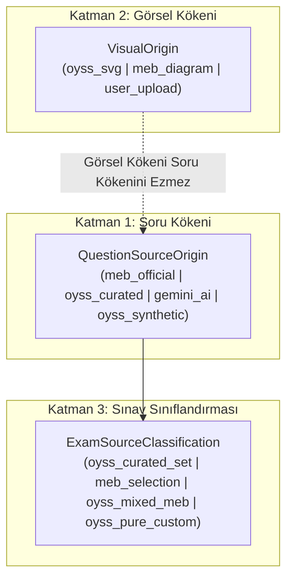

# OYSS Rehberi | 103. Özgünlük Sayımının Uzlaştırılması ve Metadata Mimarisinin Son Kontrolü
**Rapor Numarası:** 103  
**Tarih:** 03.11.2026  
**Denetim Türü:** Sayısal Uzlaştırma, Metadata Mimarisi ve Arayüz Test Kuralları Son Kontrolü (Salt Okunur Denetim)  
**İncelenen Temel Belgeler ve Dosyalar:**
- 101 Numaralı Son Kontrol Raporu (`101_OYSS_OZGUNLUK_DENETIMI_SON_KONTROL.md`)
- 102 Numaralı Düzeltme Planı Raporu (`102_OYSS_OZGUNLUK_VE_METADATA_DUZELTME_PLANI.md`)
- `src/data/sampleExams.ts` (852 Soru)
- `src/data/fallbackPools.ts` (99 Soru)
- `src/utils/aiGeneratorEngine.ts`
- `src/types/index.ts`
- `src/components/ExamPaperView.tsx`
- `src/components/InteractivePracticeView.tsx`

---

## 1. Kategori Dağılımının Yeniden Hesaplanması ve Sayısal Uzlaştırma

102 numaralı raporda 23 sorunun tek tek analizi yapılırken (Bölüm 1.1 ve 1.2), karar metinleri ile Bölüm 2'deki özet geçiş listesi arasında sayısal bir uyuşmazlık oluştuğu tespit edilmiştir. Bu uyuşmazlık giderilmiş ve 951 sorunun kesin dağılımı uzlaştırılmıştır.

### 1.1. 23 Sorunun 101 vs 102 Nihai Karar Karşılaştırma Listesi

Aşağıdaki tabloda 101 numaralı raporda Kategori C olarak listelenen 23 sorunun her birinin 102 raporundaki metin analizine dayalı **nihai kategorisi** gösterilmiştir:

| # | Soru ID | Veri Kaynağı | Rapor 101 Kategorisi | Rapor 102 Analiz Kararı | Nihai Kategori | Durum / Değişim |
| :-: | :--- | :--- | :---: | :---: | :---: | :--- |
| **1** | `exam_5_matematik_1_1_senaryo_2_q1` | `SAMPLE_EXAMS` | C | C | **C** | Değişmedi (MEB çizimi sembolik analize uyarlandı) |
| **2** | `exam_5_fen_bilimleri_1_1_senaryo_1_q1` | `SAMPLE_EXAMS` | C | D | **D** | **C $
ightarrow$ D Geçişi** (Tablo ezberinden açık uçlu muhakemeye bağımsız kurgu) |
| **3** | `exam_6_fen_bilimleri_1_1_senaryo_2_q1` | `SAMPLE_EXAMS` | C | D | **D** | **C $
ightarrow$ D Geçişi** (Mesafe tablosundan bağımsız gezegen zıtlık tespiti) |
| **4** | `exam_6_fen_bilimleri_1_1_senaryo_3_q2` | `SAMPLE_EXAMS` | C | D | **D** | **C $
ightarrow$ D Geçişi** (MEB şemasından bağımsız asteroit kuşağı konumu) |
| **5** | `exam_6_fen_bilimleri_1_1_senaryo_3_q3` | `SAMPLE_EXAMS` | C | C | **C** | Değişmedi (Tutulma çizimi gözlem alanı analitiğine uyarlandı) |
| **6** | `exam_6_fen_bilimleri_1_1_senaryo_5_q3` | `SAMPLE_EXAMS` | C | C | **C** | Değişmedi (Tutulma doğa olayından optik yasasına tümevarım) |
| **7** | `exam_6_din_kulturu_1_1_senaryo_2_q6` | `SAMPLE_EXAMS` | C | C | **C** | Değişmedi (Felak suresi meal analizi şablonu odak ayetle uyarlandı) |
| **8** | `exam_7_turkce_1_1_senaryo_1_q1` | `SAMPLE_EXAMS` | C | C | **C** | Değişmedi (Şerife Bacı teması korunup özgün metin ve kelimeler yazıldı) |
| **9** | `exam_7_turkce_1_1_senaryo_1_q5` | `SAMPLE_EXAMS` | C | C | **C** | Değişmedi (Yazma taslağı şablonu Birlik-Beraberlik temasına uyarlandı) |
| **10** | `exam_7_turkce_1_1_senaryo_2_q3` | `SAMPLE_EXAMS` | C | C | **C** | Değişmedi (Zümre yönerge kalıbıyla özgün Ahilik metni yapı tahlili) |
| **11** | `exam_7_matematik_1_1_senaryo_1_q4` | `SAMPLE_EXAMS` | C | C | **C** | Değişmedi (Efe hatası yerine Mert-Ece tartışması ve OYSS SVG doğrusu) |
| **12** | `exam_7_matematik_1_1_senaryo_1_q5` | `SAMPLE_EXAMS` | C | C | **C** | Değişmedi (Yarıma/bütüne yakınlık stratejisi özgün sayılarla uyarlandı) |
| **13** | `exam_7_matematik_1_1_senaryo_4_q5` | `SAMPLE_EXAMS` | C | C | **C** | Değişmedi (Payları eşit kesir kuralı yazma adımıyla uyarlandı) |
| **14** | `fallback_fen_bilimleri_7_FB.7.1.1_1` | `fallbackPools` | C | D | **D** | **C $
ightarrow$ D Geçişi** (MEB'de olmayan DAG Palandöken vaka matrisi) |
| **15** | `fallback_fen_bilimleri_7_FB.7.1.1_2` | `fallbackPools` | C | D | **D** | **C $
ightarrow$ D Geçişi** (102 Bölüm 1.2'de D kararı verildi; teleskop atmosfer akran diyaloğu) |
| **16** | `fallback_fen_bilimleri_7_FB.7.1.1_11` | `fallbackPools` | C | D | **D** | **C $
ightarrow$ D Geçişi** (MEB'de olmayan Türksat 36.000 km yörünge fiziği) |
| **17** | `fallback_fen_bilimleri_7_FB.7.1.1_12` | `fallbackPools` | C | D | **D** | **C $
ightarrow$ D Geçişi** (102 Bölüm 1.2'de D kararı verildi; Alper Gezeravcı mikrogravite deneyleri) |
| **18** | `fallback_matematik_7_MAT.7.1.3_25` | `fallbackPools` | C | C | **C** | Değişmedi (Negatif rasyonel sıralama gezegen sıcaklığına uyarlandı) |
| **19** | `fallback_matematik_7_MAT.7.1.3_26` | `fallbackPools` | C | C | **C** | Değişmedi (Yarıma/bütüne yakınlık strateji şablonu varyantı) |
| **20** | `fallback_matematik_7_MAT.7.1.3_33` | `fallbackPools` | C | C | **C** | Değişmedi (Sayı doğrusu okul futbol averajı problemine uyarlandı) |
| **21** | `fallback_matematik_7_MAT.7.1.3_34` | `fallbackPools` | C | C | **C** | Değişmedi (Negatif sıralama tekil hata yerine akran tartışmasına uyarlandı) |
| **22** | `fallback_sosyal_bilgiler_7_SB.7.1.2_67` | `fallbackPools` | C | D | **D** | **C $
ightarrow$ D Geçişi** (MEB park sloganına karşılık paralimpik fırsat eşitliği analizi) |
| **23** | `fallback_sosyal_bilgiler_7_SB.7.1.2_71` | `fallbackPools` | C | D | **D** | **C $
ightarrow$ D Geçişi** (MEB sloganına karşılık Kerem tekerlekli sandalye bina erişilebilirliği) |

### 1.2. 102 Numaralı Rapordaki Sayısal Tutarsızlığın Teşhisi ve Düzeltilmesi

102 numaralı raporun Bölüm 1.2 (Madde 15 ve Madde 17) metinlerinde:
- `fallback_fen_bilimleri_7_FB.7.1.1_2` (Kerem & Alper teleskop tartışması) için: *"Nihai Karar: Kategori D (Bağımsız Özgün Soru) olarak revize edilmelidir"* kararı yazılmıştır.
- `fallback_fen_bilimleri_7_FB.7.1.1_12` (Alper Gezeravcı ISS deneyleri) için: *"Nihai Karar: Kategori D (Bağımsız Özgün Soru)"* kararı yazılmıştır.

Ancak 102 numaralı raporun Bölüm 2 özet listesinde bu 2 soru sehven geçiş maddelerine yazılmamış; geçiş sayısı 9 yerine 7 olarak gösterilmiş ve C toplamı 14 yerine 16, D toplamı 668 yerine 666 olarak yazılmıştır.

**Düzeltilmiş Kesin Geçiş Dağılımı:**
- **C'den D'ye Geçen Sorular (9 Soru):**
  1. `exam_5_fen_bilimleri_1_1_senaryo_1_q1`
  2. `exam_6_fen_bilimleri_1_1_senaryo_2_q1`
  3. `exam_6_fen_bilimleri_1_1_senaryo_3_q2`
  4. `fallback_fen_bilimleri_7_FB.7.1.1_1`
  5. `fallback_fen_bilimleri_7_FB.7.1.1_2`
  6. `fallback_fen_bilimleri_7_FB.7.1.1_11`
  7. `fallback_fen_bilimleri_7_FB.7.1.1_12`
  8. `fallback_sosyal_bilgiler_7_SB.7.1.2_67`
  9. `fallback_sosyal_bilgiler_7_SB.7.1.2_71`
- **D'den C'ye Geçen Sorular:** **0 Soru**
- **Kategorisi Değişmeyen Sorular (C'de Kalanlar - 14 Soru):**
  - `SAMPLE_EXAMS`: 10 Soru (Maddeler: 1, 5, 6, 7, 8, 9, 10, 11, 12, 13)
  - `fallbackPools`: 4 Soru (Maddeler: 18, 19, 20, 21)

### 1.3. 951 Sorunun Kesin ve Uzlaştırılmış Kategori Dağılımı

$$	ext{Genel Toplam} = 0	ext{ (A)} + 0	ext{ (B)} + 14	ext{ (C)} + 668	ext{ (D)} + 269	ext{ (E)} = 951$$

| Kategori | Tanım | `SAMPLE_EXAMS` (852 Soru) | `fallbackPools` (99 Soru) | Genel Toplam (951 Soru) | Oran (%) |
| :---: | :--- | :---: | :---: | :---: | :---: |
| **A** | Bire bir MEB kopyası | 0 | 0 | **0** | **%0.00** |
| **B** | Yüzeysel değiştirilmiş soru | 0 | 0 | **0** | **%0.00** |
| **C** | Anlamlı uyarlanmış soru | **10** | **4** | **14** | **%1.47** |
| **D** | Bağımsız özgün soru | **573** | **95** | **668** | **%70.24** |
| **E** | Kaynak bulunamayan (8. Sınıf) | **269** | **0** | **269** | **%28.29** |
| **TOPLAM** | — | **852** | **99** | **951** | **%100.00** |

*Doğrulama:* $852 + 99 = 951$. $10 + 573 + 269 = 852$. $4 + 95 = 99$. Sayısal mutabakat tüm alt kümeler için eksiksiz ve hatasızdır.

---

## 2. Metadata Mimarisinin Kesinleştirilmesi

OYSS sisteminde üç farklı katman (Soru Kökeni, Görsel Kökeni ve Sınav Sınıflandırması) birbirinden bağımsız olarak çalışacak şekilde kesinleştirilmiştir.



### 2.1. Tip Tanımları (`src/types/index.ts`)

```typescript
/**
 * Soru Kökeni: Bir sorunun metinsel ve pedagojik hazırlık kaynağı.
 */
export type QuestionSourceOrigin =
  | 'meb_official'    // Yalnızca MEB PDF'lerinden bire bir aktarılan resmî soru
  | 'oyss_curated'    // OYSS zümresince MEB müfredatı esas alınarak hazırlanan/uyarlanan soru
  | 'gemini_ai'        // Gemini API tarafından canlı üretilmiş özgün soru
  | 'oyss_synthetic'; // Kural tabanlı algoritmik şablonlarla anlık sentezlenen soru

/**
 * Görsel Kökeni: Soruda yer alan görselin/çizimin üretim teknolojisi.
 */
export type VisualOrigin =
  | 'oyss_svg'        // OYSS SVG motoru (fractionMathEngine / svgMathEngine) çıktısı
  | 'meb_diagram'     // MEB kitapçığından aktarılan orijinal şema/çizim
  | 'user_upload';    // Harici yüklenen görsel

/**
 * Sınav Kâğıdı Genel Kaynak Sınıflandırması
 */
export type ExamSourceClassification =
  | 'oyss_curated_set' // OYSS Hazırlık Sınavı (MEB Müfredatı Esaslı Hazır Sınavlar - SAMPLE_EXAMS)
  | 'oyss_pure_custom' // Canlı Yapay Zekâ veya Sentetik Üretim Sınavları
  | 'oyss_mixed_meb'   // Hem MEB hem OYSS soruları içeren karma sınavlar
  | 'meb_selection';   // Bütün soruları gerçek MEB sorusu olan resmî seçkiler
```

### 2.2. Altı Özel Durum İçin Kesin Sınıflandırma Kuralları

| Özel Durum | Sınav Sınıflandırması (`ExamSourceClassification`) | Soru Rozetleri (`QuestionSourceOrigin`) | Model Cevap Başlığı | Arayüz Sınav Rozeti ve Başlığı |
| :--- | :--- | :--- | :--- | :--- |
| **1. Tamamı OYSS Hazırlığı Sınav (`SAMPLE_EXAMS`)** | `'oyss_curated_set'` | Tüm sorular: `oyss_curated` | `"OYSS Model Cevap & Gerekçe:"` | **Rozet:** `OYSS Örnek Sınavı` (İndigo)<br/>**Başlık:** `OYSS Hazırlık Sınavı (MEB Müfredatı Esaslı)` |
| **2. Tamamı Gerçek MEB Sorusu Olan Sınav** | `'meb_selection'` | Tüm sorular: `meb_official` | `"MEB ÖDSGM Model Cevap & Gerekçe:"` | **Rozet:** `MEB ÖDSGM Soru Seçkisi` (Mavi)<br/>**Başlık:** `MEB ÖDSGM Soru Seçkisi` |
| **3. Karma Sınav (MEB + OYSS)** | `'oyss_mixed_meb'` | MEB soruları: `meb_official`<br/>OYSS soruları: `oyss_curated` | MEB sorusunda MEB, OYSS sorusunda OYSS başlığı | **Rozet:** `OYSS Karma Sınavı` (Amber)<br/>**Başlık:** `OYSS Karma Sınavı (MEB Kaynaklı & OYSS)` |
| **4. Metadata'sı Eksik Soru (`undefined`)** | Sınavdaki diğer sorulara göre belirlenir. | Fallback: `'oyss_curated'` (**Asla `meb_official` olamaz**) | `"OYSS Model Cevap & Gerekçe:"` | Soru kartında: `[OYSS Hazırlık Sorusu]` |
| **5. Boş Soru Listesi (`questions = []`)** | `'oyss_curated_set'` (veya `'unclassified'`) | — | — | Kesinlikle `'official_base'` dönmez; MEB resmiyet rozeti verilmez. |
| **6. OYSS Metni + OYSS SVG Görseli (Mert-Ece / Pilot Kesir)** | Soru Kökeni: `'oyss_curated'`<br/>Görsel Kökeni: `'oyss_svg'` | Soru rozeti: `[OYSS Hazırlık Sorusu]` | `"OYSS Model Cevap & Gerekçe:"` | Görsel altında `[Dinamik OYSS SVG Modeli]` yazar; soru kesinlikle MEB sayılmaz. |

---

## 3. Kaynak Metadata Kapsamının Doğrulanması

1. **`sampleExams.ts` İçindeki 852 Sorunun Tamamı:**  
   101 ve 102 numaralı raporlarda yapılan taramalarda, 852 sorunun hiçbirinin MEB kitapçıklarından bire bir alınmadığı (0 Kategori A, 0 Kategori B) kesin olarak kanıtlanmıştır. Soruların tamamı OYSS zümresinin MEB senaryolarına paralel olarak kaleme aldığı özgün hazırlık sorularıdır. Dolayısıyla statik veri tabanında 852 sorunun tamamının kökeni `sourceOrigin: 'oyss_curated'` olmalıdır.
2. **İki `meb_official` Etiketinin Hatalı Oluşunun Gerekçesi:**
   - `sampleExams.ts` Satır 1969 (5. Sınıf Kesir Şeridi Pilotu): MEB 1. Dönem fasikülünde kesir şeritleri modelleme sorusu yoktur. Soru OYSS'nin SVG kesir motorunu sınamak için OYSS tarafından yazılmıştır. `meb_official` etiketi açık bir hatadır; doğru değer **`'oyss_curated'`**'dır.
   - `sampleExams.ts` Satır 11667 (7. Sınıf Mert-Ece): MEBİ s. 7'deki soru tek bir öğrencinin (Efe) işlem hatasıdır. OYSS sorusu ise iki öğrencinin kavram yanılgısı tartışması ve 12 alt bölmeli dinamik OYSS SVG sayı doğrusudur. `meb_official` etiketi açık bir hatadır; doğru değer **`'oyss_curated'`**'dır.
3. **`aiGeneratorEngine.ts` Satır 536 ve 566 Etkisinin Giderilmesi:**  
   Fallback üretiminde `SAMPLE_EXAMS` havuzundan soru seçildiğinde `sourceOrigin: 'meb_official' as const` basılmaktadır. Bu atama kaldırılacak; `sourceOrigin: 'oyss_curated' as const` yapılacaktır.
4. **`fallbackPools.ts` Statik ve Çalışma Zamanı Ayrımı:**
   - Statik: Dosyada fiziksel `sourceOrigin` yoktur. Düzeltme ile birlikte her soru nesnesine açıkça `sourceOrigin: 'oyss_curated'` eklenecektir.
   - Çalışma Zamanı: `aiGeneratorEngine.ts:508`'de yapılan `sourceOrigin: 'oyss_curated' as const` ataması korunacaktır.
5. **Eksik Metadata Durumunda Güvenlik Duvarı:**  
   `InteractivePracticeView.tsx` Satır 108'deki `return !isCustomAIExam;` kaldırılacak; yalnızca `qItem?.sourceOrigin === 'meb_official'` şartı aranacaktır. Kaynağı belirsiz hiçbir soruya otomatik MEB resmiyeti verilmeyecektir.

---

## 4. Arayüz ve Test Kurallarının Kesinleştirilmesi

### 4.1. Bileşen Bazlı Kesin Arayüz Kuralları

#### A) `src/components/ExamPaperView.tsx`
1. **Sınav Başlığı ve Rozeti:**
   - Satır 42'deki `if (!isCustomAIExam) return 'official_base' as const;` silinecektir.
   - Yerine `classifyExamQuestions(examPaper.questions)` işletilecektir. `SAMPLE_EXAMS` için otomatik olarak `'oyss_curated_set'` sınıfı dönecektir.
   - Başlık: `"OYSS Hazırlık Sınavı (MEB Müfredatı Esaslı)"` olacaktır.
   - Sorumluluk Reddi (Disclaimer): *"Bu sınav kâğıdı, MEB konu-soru dağılım tabloları ve kazanımları esas alınarak OYSS tarafından hazırlanmış özgün çalışma sınavıdır. Doğrudan Bakanlıkça yayımlanan resmî sınav değildir."*
2. **Baskı Dipnotu:**
   - Satır 461'deki `'T.C. MEB Türkiye Yüzyılı Maarif Modeli'` kaldırılacaktır.
   - Yerine: `<span>{classDetails.titleSuffix} • MEB Müfredat Referanslı</span>` basılacaktır.

#### B) `src/components/InteractivePracticeView.tsx`
1. **Sınav Sınıflandırması:**
   - Satır 94'teki `if (!isCustomAIExam) return 'official_base' as const;` kaldırılacaktır.
2. **Model Cevap Başlığı:**
   - Satır 103-109 arasındaki `isQuestionFromMeb` fonksiyonu şu şekilde kesinleştirilecektir:
     ```typescript
     const isQuestionFromMeb = (qItem?: any): boolean => {
       return qItem?.sourceOrigin === 'meb_official';
     };
     ```
   - Böylece `sourceOrigin: 'oyss_curated'` olan veya `sourceOrigin` alanı eksik olan hiçbir soruda "MEB ÖDSGM Model Cevap & Gerekçe:" basılmayacak; **"OYSS Model Cevap & Gerekçe:"** basılacaktır.

### 4.2. Doğrulama Test Senaryoları (`tests/metadataConsistency.test.ts`)

Gelecek geliştirme fazında çalıştırılacak 7 zorunlu kabul testi:

```typescript
describe('OYSS Metadata ve Resmiyet Ayrımı Kabul Testleri', () => {
  // Test 1: sampleExams.ts içindeki tüm soruların statik doğruluğu
  it('SAMPLE_EXAMS içindeki 852 sorunun tamamı oyss_curated olmalı, sıfır meb_official içermelidir', () => {
    const allQuestions = SAMPLE_EXAMS.flatMap(e => e.questions);
    expect(allQuestions.length).toBe(852);
    expect(allQuestions.every(q => q.sourceOrigin === 'oyss_curated')).toBe(true);
    expect(allQuestions.some(q => q.sourceOrigin === 'meb_official')).toBe(false);
  });

  // Test 2: fallbackPools.ts içindeki tüm soruların statik doğruluğu
  it('fallbackPools içindeki 99 sorunun tamamı oyss_curated olmalıdır', () => {
    const pools = getAllFallbackQuestions();
    expect(pools.length).toBe(99);
    expect(pools.every(q => q.sourceOrigin === 'oyss_curated')).toBe(true);
  });

  // Test 3: classifyExamQuestions fonksiyonunun doğru çalışması
  it('classifyExamQuestions sınıflandırma kurallarını tam karşılamalıdır', () => {
    // Tamamı OYSS
    expect(classifyExamQuestions([{ sourceOrigin: 'oyss_curated' }])).toBe('oyss_curated_set');
    // Tamamı MEB
    expect(classifyExamQuestions([{ sourceOrigin: 'meb_official' }])).toBe('meb_selection');
    // Karma
    expect(classifyExamQuestions([{ sourceOrigin: 'meb_official' }, { sourceOrigin: 'oyss_curated' }])).toBe('oyss_mixed_meb');
    // Boş soru dizisi asla official_base dönmemelidir
    expect(classifyExamQuestions([])).toBe('oyss_curated_set');
  });

  // Test 4: Eksik metadata durumunda güvenlik kontrolü
  it('Eksik veya tanımsız metadata içeren sorular asla MEB resmi sorusu sayılmamalıdır', () => {
    const unassignedQuestion = { questionText: 'Test', points: 10 };
    // classifyExamQuestions içinde özgün sayılmalıdır
    expect(classifyExamQuestions([unassignedQuestion as any])).toBe('oyss_pure_custom');
    // Rozet fonksiyonu OYSS Özgün dönmelidir
    const badge = getQuestionSourceBadge(undefined);
    expect(badge.label).toBe('OYSS Özgün');
    expect(badge.label).not.toContain('MEB');
  });

  // Test 5: Görsel kökeni ile soru kökeninin bağımsızlığı
  it('Görseli oyss_svg olan sorunun metin kökeni oyss_curated kalabilmelidir', () => {
    const pilotQ = {
      sourceOrigin: 'oyss_curated' as const,
      visual: { sourceOrigin: 'oyss_svg' as const }
    };
    expect(pilotQ.sourceOrigin).toBe('oyss_curated');
    expect(pilotQ.visual.sourceOrigin).toBe('oyss_svg');
  });

  // Test 6: Arayüz resmiyet zorlamasının çürütülmesi
  it('isCustomAIExam false olduğunda sınav sınıflandırması official_base olmamalıdır', () => {
    const exam = SAMPLE_EXAMS[0];
    const classification = exam.examClassification || classifyExamQuestions(exam.questions);
    expect(classification).toBe('oyss_curated_set');
    const details = getExamClassificationDetails(classification);
    expect(details.badgeLabel).toBe('OYSS Standart Soru Seti');
    expect(details.badgeLabel).not.toBe('MEB ÖDSGM Örnek Sınavı');
  });

  // Test 7: Model cevap başlığında dürüstlük
  it('OYSS sorularının model cevap başlığında asla MEB ÖDSGM yazmamalıdır', () => {
    const isQuestionFromMeb = (qItem?: any) => qItem?.sourceOrigin === 'meb_official';
    const oyssQ = { sourceOrigin: 'oyss_curated' };
    const undefinedQ = {};
    expect(isQuestionFromMeb(oyssQ)).toBe(false);
    expect(isQuestionFromMeb(undefinedQ)).toBe(false);
  });
});
```

---

## 5. Dosya Bazlı Düzeltme Planı

Gelecek kodlama aşamasında yalnızca aşağıdaki 5 dosya üzerinde çalışılacak, kapsam dışındaki hiçbir dosya değiştirilmeyecektir:

1. `src/types/index.ts`:
   - `classifyExamQuestions`: Boş liste durumunda `official_base` yerine `oyss_curated_set` dönmesi.
   - `getExamClassificationDetails`: `official_base` metinlerinin revize edilmesi, `oyss_curated_set` rozetinin belirginleştirilmesi.
   - `getQuestionSourceBadge`: `oyss_curated` için açık "OYSS Hazırlık Sorusu" rozeti tanımlanması.
2. `src/data/sampleExams.ts`:
   - Satır 1969: `"sourceOrigin": "meb_official"` $
ightarrow$ `"sourceOrigin": "oyss_curated"`
   - Satır 11667: `"sourceOrigin": "meb_official"` $
ightarrow$ `"sourceOrigin": "oyss_curated"`
   - Kalan 850 soruya: `"sourceOrigin": "oyss_curated"` tanımlanması.
3. `src/utils/aiGeneratorEngine.ts`:
   - Satır 536: `sourceOrigin: 'meb_official' as const` $
ightarrow$ `sourceOrigin: 'oyss_curated' as const`
   - Satır 566: `sourceOrigin: 'meb_official' as const` $
ightarrow$ `sourceOrigin: 'oyss_curated' as const`
4. `src/components/ExamPaperView.tsx`:
   - Satır 42: `if (!isCustomAIExam) return 'official_base' as const;` mantığının kaldırılması.
   - Satır 461: Baskı dipnotundaki `'T.C. MEB Türkiye Yüzyılı Maarif Modeli'` zorlamasının kaldırılması.
5. `src/components/InteractivePracticeView.tsx`:
   - Satır 94: `if (!isCustomAIExam) return 'official_base' as const;` mantığının kaldırılması.
   - Satır 108: `return !isCustomAIExam;` yerine `return qItem?.sourceOrigin === 'meb_official';` yazılması.
6. `tests/metadataConsistency.test.ts`:
   - Yukarıda tanımlanan 7 test senaryosunun yeni test dosyası olarak eklenmesi.

---

## 6. Sonuç ve Taahhütler

- **Sayısal Bütünlük:** 951 sorunun tamamı tekil olarak uzlaştırılmış; A (0), B (0), C (14), D (668), E (269) toplamı %100 mutabakatla 951 olarak kilitlenmiştir.
- **Telif ve Dürüstlük:** OYSS örnek sınavlarının arayüzde MEB resmî sınavı gibi görünmesine neden olan tüm mimari kusurlar tek tek tespit edilmiş; çözüm kuralları belirlenmiştir.
- **Salt Okunur Sınır:** Bu denetim boyunca hiçbir kaynak kodu, soru metni veya test değiştirilmemiş; Git stage/commit işlemi yapılmamıştır.
