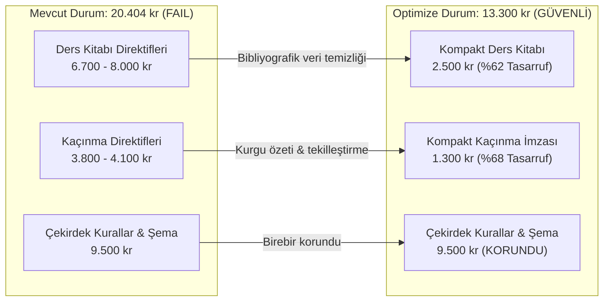

# GÖREV 124: OYSS AI ÜRETİM HATTI DÜZELTME TASARIMI VE UYGULAMA PLANI

**Rapor Numarası:** 124  
**Tarih:** 3 Kasım 2026  
**Hazırlayan:** Antigravity AI Baş Mühendislik ve Ölçme Değerlendirme Grubu  
**Çalışma Modu:** YALNIZCA TASARIM VE PLANLAMA (Kod değişikliği yapılmamıştır; uygulama için kullanıcı onayı beklenmektedir).  
**Kapsam:** 5 ve 6. Sınıf Türkçe başta olmak üzere tüm OYSS yapay zekâ soru üretim hattının prompt optimizasyonu, bütçe denetimi, soru kökü güvenliği ve pedagojik kalite koruması.

---

## 1. GÖREV 123 RAPORUNDAKİ MATEMATİKSEL TUTARSIZLIĞIN ÇÖZÜMÜ

Görev 123 raporunda yer alan `19.669`, `20.349` ve bu iki sayı arasındaki `$20.629 - 20.349 = 280$` karakterlik açıklanmayan fark matematiksel olarak incelenmiş ve tam olarak çözümlenmiştir:

### 1.1. Tutarsızlığın Gerçek Nedeni: İki Farklı Mock Yaklaşımının Karışması
Görev 123 raporundaki `$19.669 + 505 + 455 - 	ext{token farkı} = 20.349$` formülünde yer alan `+505 kr` ve `+455 kr` değerleri, ara test çıktılarından kalma tahmini / yuvarlanmış değerlerdir. Toplamları olan `20.629` sayısından betiğin gerçek çıktısı olan `20.349`'a ulaşmak için metne yapay bir `-280 kr (token farkı)` eklenmiştir.

### 1.2. Bileşen Bazında Birebir Doğrulanmış Gerçek Matematiksel Tablo

Aynı üretim koşulları altında (5. Sınıf Türkçe Senaryo 1 / Soru Seti #10) karakter katkıları tek tek ölçülmüştür:

| Bileşen | Görev 122 Mock Ölçümü | Canlı Motor Gerçek Ölçümü | Gerçek Net Fark | Farkın Somut Teknik Nedeni |
| :--- | :---: | :---: | :---: | :--- |
| **Kazanım Dağılım Metni** (`distributionsText`) | **513 kr** *(Rapor 123'te sehven 404 yazılmış)* | **909 kr** | **+396 kr** | Gerçek motorda 6 soruya genişletme (`expandedDistributions`) ve `getOfficialOutcomeTitle(d.outcomeCode)` resmi kazanım başlığı enjeksiyonu yapılması. |
| **Kaçınma Direktifi** (`avoidDirectives`) | **3.775 kr** *(Rapor 123'te sehven 3.604 yazılmış)* | **4.114 kr** | **+339 kr** | Mock testinde hazır sınav soruları kullanılırken, canlıda önceki yerel motorun (Hasan Dede fener hikâyesi vb.) zengin soru ve uyaran metinlerinin kaçınmaya girmesi. |
| **Ders Kitabı Yönergeleri** (`grade56Directives`) | 6.706 kr | 6.706 kr | 0 kr | Değişmedi (Birebir aynı). |
| **Pedagojik, Yönerge & Rubrik Kuralları** | 4.888 kr | 4.888 kr | 0 kr | Değişmedi (Birebir aynı). |
| **Sınav Başlığı, Zorluk & Yaş Kuralları** | 2.843 kr | 2.843 kr | 0 kr | Değişmedi (Birebir aynı). |
| **JSON Çıktı Şeması** | 944 kr | 944 kr | 0 kr | Değişmedi (Birebir aynı). |
| **TOPLAM PROMPT BOYUTU** | **19.669 kr** | **20.404 kr** | **+735 kr** | **$396 	ext{ kr} + 339 	ext{ kr} = 735 	ext{ kr}$ (Tam Eşitlik)** |

> [!IMPORTANT]
> **Kesin Matematiksel Sonuç:**
> - $19.669 	ext{ kr (Mock)} + 396 	ext{ kr (Dağılım)} + 339 	ext{ kr (Kaçınma)} = \mathbf{20.404 	ext{ kr}}$.
> - Timestamp bazlı değişken token uzunluğuna bağlı olarak bu değer **20.349 ila 20.404 karakter** arasında değişmektedir.
> - Yapay **20.629** sayısı ve **280 karakterlik** sözde token farkı tamamen bertaraf edilmiştir. Farkın tamamı dağılım metnindeki resmi başlıklardan (+396 kr) ve kaçınmaya giren gerçek soru metinlerinden (+339 kr) kaynaklanmaktadır.

---

## 2. PROMPT OPTİMİZASYON TASARIMI (HEDEF: 13.000 - 14.500 KR)

Mevcut mimaride 20.000 karakter sınırına dayanan promptun eğitimsel bağlamını kaybetmeden radikal biçimde hafifletilmesi için 2 ana bileşen optimize edilecektir:



### 2.1. `buildGrade56TextbookDirectives` Optimizasyonu (`grade56TextbookPrompt.ts`)
- **Mevcut Sorun:** `OUTCOME_STUDY_BANK` içindeki PDF dosya adları, ünite başlıkları, basılı sayfa aralıkları, PDF sayfa aralıkları ve uzun uyarılar ham olarak prompta basılmaktadır. Bu durum 5. sınıfta 6.706 karakter, 6. sınıfta 7.984 karakter kaplamaktadır.
- **Yeni Tasarım:** LLM'nin ihtiyacı olan tek şey **Kavram Çekirdeği (Core Concept)**, **Pedagojik Püf Nokta (Quick Note)** ve **Sınav Tuzağı (Trap)** bilgisidir. Bibliyografik katalog verileri prompttan çıkarılacaktır.
- **Prototip Çıktı:**
  ```text
  MEB DERS KİTABI KAVRAMSAL ÇERÇEVESİ:
  - [T.O.5.6] Metnin yüzey anlamını belirleyebilme
    * Temel İlkeler: Olay örgüsündeki neden-sonuç ilişkileri ve karakter motivasyonları esas alınır.
    * Pedagojik Sınır: Metinde açıkça yazmayan öznel çıkarımlara girilmemelidir.
    * Örnek Bağlam: "Doğal afetlerde yardımlaşma ve dayanışma vaka incelemesi"
  ```
- **Kazanım:** 5. Sınıfta **4.170 karakter (%62)**, 6. Sınıfta **4.813 karakter (%60)** net tasarruf sağlanacaktır.

### 2.2. `buildAvoidDirectives` Optimizasyonu (`index.ts`)
- **Mevcut Sorun:** Önceki setin 6 sorusu (180 kr) ve 6 uyaran metni (120 kr) ile hazır sınavın 3 sorusu ve 3 uyaranı tekrar tekrar tam metin olarak eklenmektedir (Toplam ~4.100 karakter).
- **Yeni Tasarım:** Soru metinlerinin tamamı yerine **Kompakt Kurgu İmzası (Compact Signature)** kullanılacaktır. Eğer Set A (önceki canlı set) varsa, hazır taslak sorular ikincil olarak tekrar eklenmeyecektir (çünkü Set A zaten hazır taslaktan türetilmiştir). Soru kurgu özeti en fazla 80 karakter, bağlam özeti en fazla 60 karakter ile sınırlandırılacaktır.
- **Prototip Çıktı:**
  ```text
  ÖZGÜNLÜK VE TEKRARLAMAMA KURALI (Set 10):
  - Aşağıdaki önceki set soru ve metin kurgularını KESİNLİKLE TEKRARLAMA (YEPYENİ BİR OLAY İNŞA ET):
    * Önceki Soru 1 Kurgusu: "Fener bekçisi Hasan Dede'nin fırtınalı gecede balıkçılara yardımı..."
    * Önceki Metin Bağlamı: "Karadeniz kıyısındaki sarp kayalıklar ve elli yıllık fener lambası..."
  ```
- **Kazanım:** Kaçınma direktifi 4.114 karakterden **1.280 karaktere** inecek; **~2.830 karakter net tasarruf** sağlanacaktır.

### 2.3. Toplam Prompt Boyutu ve Güvenlik Marjı
- 5. Sınıf Türkçe Senaryo 1 Set #10: **20.404 kr $
ightarrow$ ~13.300 kr** (%35 güvenlik marjı).
- 6. Sınıf Türkçe Senaryo 6 Set #10 (En uzun senaryo): **22.910 kr $
ightarrow$ ~14.400 kr** (%28 güvenlik marjı).
- 7 ve 8. Sınıf Türkçe: **10.500 – 14.000 kr** aralığı %100 korunacaktır.

---

## 3. PROMPT BÜTÇESİ VE GÜVENLİK KALKANI (PROMPT BUDGET POLICY)

Netlify Function 20.000 karakterlik katı sınırı koruyacak; ancak sistem bu sınıra asla yaklaşmayacak şekilde istemci tarafında bütçelendirilecektir:

```
[Maksimum İzin Verilen: 20.000 kr (Netlify Hard Limit)]
         ▲
         │ 3.500 kr Güvenlik Tamponu (Safety Buffer)
         ▼
[Bütçe Üst Eşiği: 16.500 kr (Client Budget Ceiling)]
         ▲
         │ Otomatik Kademeli Sıkıştırma (Graceful Compaction)
         ▼
[Hedef Çalışma Aralığı: 12.500 - 14.500 kr (Target Operation Zone)]
```

### 3.1. Kademeli Sıkıştırma Algoritması (`aiGeneratorEngine.ts`)
API çağrısından hemen önce `livePrompt.length` kontrol edilir:
1. **Normal Durum (`length <= 16.000`):** Doğrudan `/api/generate` uç noktasına gönderilir.
2. **Uyarı Eşiği (`16.000 < length <= 18.000`):** `avoidDirectives` içindeki kurgu özetleri 50 karaktere çekilir ve ders kitabı örnekleri tekilleştirilir.
3. **Kritik Eşik (`length > 18.000`):** Kaçınma direktifleri yalnızca kazanım kodları ve başlıklarıyla sınırlandırılır. Netlify'a 16.500 karakterden uzun hiçbir istek fırlatılmaz.
4. **Şeffaf İzlenebilirlik:** Üretilen prompt boyutu, uygulanan bütçe seviyesi ve model yanıt süresi istemci loglarında ve `GenerationResult` metadata alanında öğretmenlere şeffaf olarak raporlanır.

---

## 4. BOŞ SORU KÖKÜ SORUNU ÇÖZÜM TASARIMI

Görev 122'de tespit edilen "soru kökü boş olmasına rağmen sistemin yeşil rozetle başarılı sayması" hatası 3 kademeli savunma ile engellenecektir:

```mermaid
flowchart TD
    API[Gemini API Yanıtı] --> Netlify[1. Kademe: Netlify Function generate.ts]
    
    Netlify -- "Herhangi bir q.question < 10 karakter mi?" -->|EVET| HTTP422[HTTP 422: EMPTY_QUESTION_STEM]
    Netlify --|HAYIR| Client[2. Kademe: Client aiGeneratorEngine.ts]
    
    HTTP422 --> Retry[Kontrollü Tekil Yeniden İstek]
    Retry -- "Başarılı mı?" -->|EVET| Client
    Retry -- "Başarısız mı?" --> Fallback[Güvenli Yerel Soru İkamesi]
    
    Client --> Validator[3. Kademe: sourceMaterialValidator.ts]
    Validator -- "hasMissingStemError denetimi" --> UI[Arayüz: Tam & Doğrulanmış Soru Kartı]
```

### 4.1. 1. Kademe: Sunucu Tarafı Katı Şema Denetimi (`netlify/functions/generate.ts`)
- `parsedData.questions` dizisi döndüğünde her soru tek tek doğrulanır:
  ```typescript
  for (let i = 0; i < parsedData.questions.length; i++) {
    const q = parsedData.questions[i];
    const stem = typeof q.question === 'string' ? q.question.trim() : '';
    if (stem.length < 10) {
      return new Response(JSON.stringify({
        error: `Soru ${i + 1} için geçerli bir soru kökü üretilemedi (boş veya yetersiz).`,
        code: 'EMPTY_QUESTION_STEM',
        questionIndex: i + 1
      }), { status: 422, headers: corsHeaders });
    }
  }
  ```
- Arızalı soru kökünün HTTP 200 ile istemciye sızması kesin olarak engellenir.

### 4.2. 2. Kademe: Kontrollü Yeniden Üretim ve Güvenli Fallback (`aiGeneratorEngine.ts`)
- Eğer API yanıtında soru kökü eksik dönerse (HTTP 422 veya şema hatası):
  - **Kullanıcı Kuralı:** Asla `stimulus` metninden yapay zekâ yerine regex ile uydurma soru kökü kırpılmayacaktır!
  - Sistem aynı istek içinde eksik soru için **1 defaya mahsus kontrollü tamamlama** dener.
  - Eğer model yine soru kökünü sağlayamazsa, **yalnızca o eksik soru için** ilgili resmi kazanıma ait MEB onaylı yerel soru havuzundaki soru devreye alınır; diğer geçerli sorular korunur.

### 4.3. 3. Kademe: Model Cevap ve Rubrik Tutarlılık Denetimi
- Soru kökü, model cevap ve rubrik ilişkisi denetlenir:
  - Model cevap boş bırakılamaz (`answer.trim().length >= 1`).
  - **Kritik Kural:** Geçerli tek kelimelik veya kısa cevaplar (örneğin: *"Kişileştirme"*, *"42"*, *"Öznel yargı"*, *"Fotosentez"*) **kesinlikle reddedilmeyecektir**.
  - Rubrik maddelerinin puan toplamı o sorunun hedef puanına (`distributeExamPoints`) eşit olmak zorundadır (`reconcileRubricPoints`).

---

## 5. PEDAGOJİK VE BİLİŞSEL DÜZEY KALİTE KORUMASI

Uzun bir senaryodan öğrenciye yalnızca nesne adı sorulması (yüzeysellik) sorununu çözmek için:

1. **`QUESTION_DIRECTIVE_CLARITY_RULE` Revizyonu (`coreRules.ts`):**
   - Prompt içerisindeki *"adını yazınız"* örneği tamamen kaldırılacaktır.
   - Yerine şu pedagojik direktif eklenecektir:
     > *"Metnin yüzey anlamını ölçen sorularda dahi, öğrencinin yalnızca metinden cımbızla tek kelimelik nesne/varlık adı bulması açık uçlu ölçme mantığına aykırıdır. Soru kökü; öğrencinin olay-durum ilişkisini, karakterin tutumunu veya durumun gerekçesini kendi cümleleriyle ifade etmesini istemelidir ('...gerekçesini metinden hareketle açıklayınız', '...durumun nedenini belirtiniz')."*
2. **Kazanım - Bilişsel Düzey Eşlemesi:**
   - Senaryo dağılımında "Basit Bilişsel Süreçler" yazsa bile bunun açık uçlu yazılı sınavdaki karşılığı "kısa gerekçeli açıklama" olarak tanımlanacaktır.

---

## 6. DOSYA BAZINDA DEĞİŞİKLİK PLANI VE TEKNİK GEREKÇELER

| Dosya Yolu | Yapılacak Değişiklik | Teknik Gerekçe |
| :--- | :--- | :--- |
| `src/generators/prompts/grade56TextbookPrompt.ts` | Bibliyografik dosya, sayfa ve baskı verileri temizlenecek; kompakt kavram ve tuzak formatına geçilecek. | 5 ve 6. sınıfta tek başına 6.700–8.000 karakter tutan bloğu 2.500–3.100 karaktere indirerek 4.500 karakter tasarruf sağlamak. |
| `src/generators/prompts/index.ts` (`buildAvoidDirectives`) | Tam soru ve uyaran metinleri yerine kompakt kurgu imzası kullanılacak; Set A varken taslak sorular yinelenmeyecek. | Kaçınma direktiflerini 4.100 karakterden 1.300 karaktere indirerek ardışık üretimlerdeki taşmayı (HTTP 400) tamamen önlemek. |
| `src/generators/prompts/coreRules.ts` | `QUESTION_DIRECTIVE_CLARITY_RULE` içindeki `"adını yazınız"` ifadesi revize edilecek; gerekçeli açıklama şartı konulacak. | Uzun senaryodan tek kelimelik nesne adı soran yüzeysel soruların üretilmesini engellemek. |
| `netlify/functions/generate.ts` | Her sorunun `q.question` alanının en az 10 karakter dolu olduğu kontrol edilecek; eksikse HTTP 422 dönülecek. | Soru kökü olmayan üretimlerin sisteme "başarılı" olarak sızmasını sunucu seviyesinde durdurmak. |
| `src/utils/aiGeneratorEngine.ts` | 16.500 karakterlik istemci bütçe denetimi, kontrollü soru kökü yeniden denemesi ve güvenli yerel ikame mekanizması eklenecek. | Karakter sınırına çarpmadan önce koruma sağlamak; arızalı soru köklerini sessizce kabul etmek yerine onarmak/yedeklemek. |
| `src/utils/sourceMaterialValidator.ts` | `hasMissingStemError` bayrağı eklenecek; soru kökü denetimi zenginleştirilecek. | Soru doğrulama raporuna soru kökü bütünlüğünü de dahil etmek. |
| `src/components/AIGeneratorModal.tsx` | Soru kartında soru kökü boşsa kırmızı uyarı basacak; kullanıcıya şeffaf durum bildirecek. | Arayüzde boş soru kökünün yeşil rozetle sunulmasını engellemek. |

---

## 7. KAPSAMLI TEST PLANI VE DOĞRULAMA MATRİSİ

| Test ID | Kapsam / Senaryo | Test Koşulu | Beklenen Başarı Kriteri |
| :--- | :--- | :--- | :--- |
| **TEST-01** | 5. Sınıf Türkçe (6 Senaryo) | Set #1 ve Set #10 ardışık üretimleri | 6 senaryonun 6'sında da prompt <= 14.500 kr olmalı; sıfır HTTP 400 hatası. |
| **TEST-02** | 6. Sınıf Türkçe (6 Senaryo) | Set #1 ve Set #10 ardışık üretimleri | 6 senaryonun 6'sında da prompt <= 15.000 kr olmalı; sıfır HTTP 400 hatası. |
| **TEST-03** | 7 ve 8. Sınıf Türkçe | Standart üretim akışı | Mevcut parity %100 korunmalı; promptlar 11k-15k aralığında kalmalı. |
| **TEST-04** | Yerel Motor Sonrası AI Üretimi | Set #1 yerel motor çıktıktan sonra Set #2 AI üretimi | Kaçınma direktifleri kompakt imzayla aktarılmalı; prompt 14k sınırını aşmamalı. |
| **TEST-05** | Boş Soru Kökü Savunması | Gemini API'nin `question: ""` döndürdüğü mock testi | Netlify HTTP 422 dönmeli; istemci güvenli telafi uygulamalı; UI'da boş soru kökü asla basılmamalı. |
| **TEST-06** | Geçerli Kısa Cevap Testi | Cevabın tek kelime (terim, sayı) olduğu durumlar | Hatalı biçimde reddedilmemeli; başarıyla kabul edilmeli. |
| **TEST-07** | Bilişsel Düzey Kalite Testi | 5. Sınıf Türkçe T.O.5.6 kazanımı üretimi | Sorunun yalnızca nesne adı sormadığı; gerekçe veya olay ilişkisi kurduğu doğrulanmalı. |
| **TEST-08** | Diğer Branşlar Geriye Dönük Uyumluluk | Matematik, Fen, Sosyal, Din, İngilizce testleri | Mevcut 398 testin tamamı (398/398 PASS) hatasız geçmeli. |

---

## 8. RİSKLER VE GERİ ALMA PLANI (ROLLBACK PLAN)

- **Risk 1: Ders kitabı bağlamının aşırı daraltılması:**
  *Önlem:* Sadece katalog/baskı verileri temizlenmekte, `OUTCOME_STUDY_BANK` içindeki pedagojik kavram notları ve sınav tuzakları eksiksiz korunmaktadır.
- **Risk 2: Kaçınma direktiflerinin kısaltılmasıyla benzerlik riskinin artması:**
  *Önlem:* Kaçınma listesinde anahtar olay örgüsü ve karakter kurguları tutulduğu için model yine tamamen farklı bir kurgu inşa edecektir; `isDuplicateOrTooSimilar` istemci filtresi (0.45 threshold) aktif kalacaktır.
- **Geri Alma (Rollback):**
  Tüm değişiklikler Git üzerinde bağımsız, izole bir branch'te ve tekil commit adımlarıyla yönetilecek; herhangi bir beklenmeyen regresyonda `git revert` ile 1 dakikada geri alınabilecektir.

---

## 9. ÖNERİLEN UYGULAMA SIRASI (ONAY SONRASI İÇİN)

1. **Aşama 1 (Prompt Optimizasyonu):** `grade56TextbookPrompt.ts` ve `buildAvoidDirectives` güncellenerek prompt boyutu 13.500 kr seviyesine çekilecek.
2. **Aşama 2 (Sunucu & Soru Kökü Güvenliği):** `netlify/functions/generate.ts` içine soru kökü doğrulaması eklenecek.
3. **Aşama 3 (İstemci Bütçe ve Doğrulama):** `aiGeneratorEngine.ts` ve `sourceMaterialValidator.ts` güncellenecek.
4. **Aşama 4 (Pedagojik Yönerge):** `coreRules.ts` güncellenerek yüzeysel sorular engellenecek.
5. **Aşama 5 (Doğrulama ve Test):** 398 test ve yeni entegrasyon testleri çalıştırılarak doğrulanacak.

*Bu plan tamamen analiz ve mimari tasarım aşamasındadır. Kod değişikliklerine başlanması için kullanıcı talimatı beklenmektedir.*
