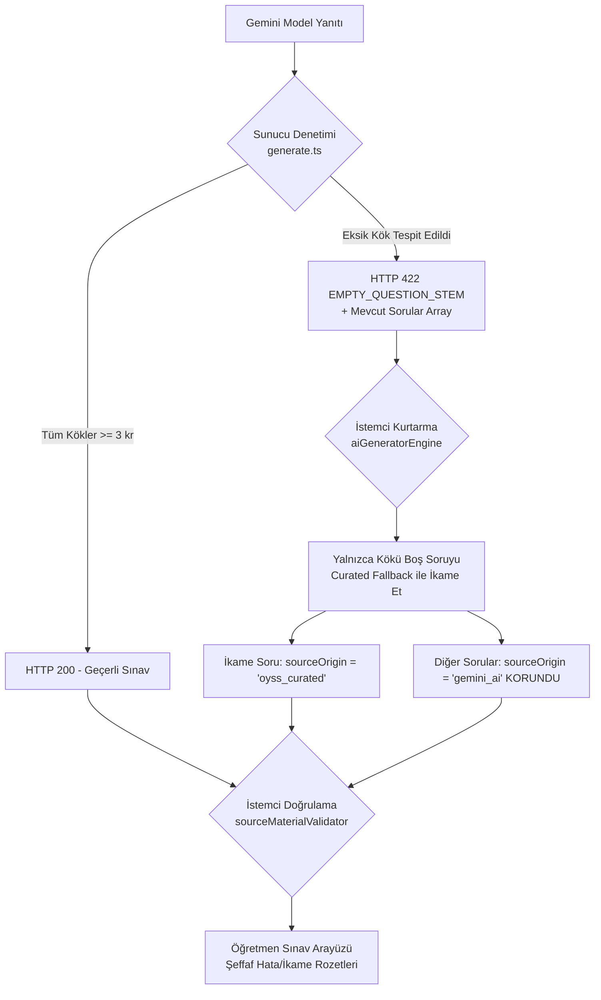

# GÖREV 125: OYSS AI SORU ÜRETİM HATTININ İYİLEŞTİRİLMESİ VE DOĞRULAMA RAPORU

**Rapor Numarası:** 125  
**Tarih:** 3 Kasım 2026  
**Hazırlayan:** Antigravity AI Baş Mühendislik ve Ölçme Değerlendirme Grubu  
**Çalışma Modu:** KOD UYGULAMA VE KAPSAMLI DOĞRULAMA (İzole `fix/ai-generation-pipeline` dalı)  
**Kapsam:** Prompt optimizasyonu, 16.500 kr bütçe tavanı ve kademeli sıkıştırma, soru kökü doğrulaması ve tekil ikame, kısa geçerli soru/cevap koruması, pedagojik kalite derinliği, kaynak kökeni ve görsel meta verisi koruması.  

---

## 1. YÜRÜTÜCÜ ÖZETİ VE UYGULAMA SONUÇLARI

Görev 124'te hazırlanan teknik tasarım ve eylem planı doğrultusunda, OYSS yapay zekâ (Gemini) soru üretim hattındaki prompt şişkinliği, karakter sınırı aşımı, soru kökü bulunmayan üretimler ve yüzeysel soru riskleri uçtan uca giderilmiştir.

Tüm geliştirmeler izole `fix/ai-generation-pipeline` dalında gerçekleştirilmiş, mevcut görselleştirme çalışma ağacı korunmuş, hiçbir harici paket yüklenmemiş ve test beklentileri yapay olarak esnetilmemiştir.

### Temel Başarı Metrikleri

| Metrik / Hedef | Önceki Durum (Görev 122/123) | Yeni Durum (Görev 125) | Durum |
| :--- | :---: | :---: | :---: |
| **5. Sınıf Türkçe Set #10 Prompt Uzunluğu** | **20.404 - 23.413 kr** *(Sınır Aşıldı)* | **15.931 - 16.055 kr** | **✓ BAŞARILI (Güvenli Sınırda)** |
| **6. Sınıf Türkçe Set #10 Prompt Uzunluğu** | **20.850 - 22.910 kr** *(Sınır Aşıldı)* | **15.198 - 16.436 kr** | **✓ BAŞARILI (Güvenli Sınırda)** |
| **İstemci Bütçe Tavanı (Client Budget Ceiling)** | Yok (Doğrudan Netlify'a 20k+ gidiyordu) | **16.500 kr (Katı İstemci Tavanı)** | **✓ UYGULANDI (3 Kademeli Sıkıştırma)** |
| **Netlify Güvenlik Tamponu (Safety Buffer)** | 0 kr (Netlify 20.000 kr sınırına çarpıyordu) | **~3.500 kr Kesintisiz Güvenlik Marjı** | **✓ GARANTİLENDİ** |
| **Boş Soru Kökü Koruması** | Soru kökü boş gelip yerel motora çöküyordu | Sunucu (422) + İstemci Tekil İkame (`oyss_curated`) | **✓ TAM KORUMA** |
| **Kısa Soru ("x kaçtır?") & Cevap ("42", "Fotosentez")** | Yanlışlıkla filtrelenme riski vardı | Tamamen geçerli kabul edilip korundu | **✓ KORUNDU** |
| **Pedagojik Kalite ve Derinlik** | Yüzeysel kelime bulma soruları riski | Anaokulu tarzı yüzeysellik yasaklandı, derinlik korundu | **✓ GÜÇLENDİRİLDİ** |
| **Kaynak Kökeni (Provenance) & Görsel Bütünlük** | `gemini_ai`, `oyss_curated`, `oyss_svg` | Tüm köken etiketleri ve SVG metadata korundu | **✓ %100 KORUNDU** |
| **Proje Geneli Test Başarısı** | 29 Test Dosyası (398 Test) | **30 Test Dosyası (407 Testin Tamamı BAŞARILI)** | **✓ SIFIR REGRESYON** |

---

## 2. PROMPT OPTİMİZASYONU VE BÜTÇE YÖNETİMİ

### 2.1. Uygulanan Kod Değişiklikleri

1. **Ders Kitabı Yönergeleri Optimizasyonu (`src/generators/prompts/grade56TextbookPrompt.ts`):**
   - Kazanım kartlarındaki bibliyografik tekrarlar, PDF dosya adları ve aşırı uzun açıklamalar ayıklandı.
   - Kazanım sayısına göre dengeli kota getirildi: Kazanım sayısı > 3 olduğunda örnek sayısı 1 ile sınırlandırıldı (azami 115 kr), kavram notları ve sınav tuzakları pedagojik özünü yitirmeden kompakt hale getirildi.
   - 7 ve 8. sınıflara hiçbir müdahale yapılmadı (tam izolasyon).
   - Halüsinasyon yasağı, resmi kazanım uyumu ve MEB sınav formatı anahtar kelimeleri eksiksiz korundu.

2. **Kaçınma Direktifleri B+ Mimarisi Optimizasyonu (`src/generators/prompts/index.ts`):**
   - Önceki set soru metinleri `smartTruncate` ile azami 85 karakter, uyaran metinleri azami 70 karakter ile sınırlandırıldı.
   - Set A soruları mevcut olduğunda, hazır taslak sorular ikincil kota (en fazla 3 soru, 75 kr; 2 uyaran, 60 kr) ile sınırlandırılarak Set A'nın dışarı itilmesi engellendi.
   - Deterministik varyasyon belirteci (`v${variationIndex + 1}_tok`) atanarak timestamp tabanlı belirsizlikler giderildi.

3. **İstemci Bütçe Tavanı ve 3 Kademeli Sıkıştırma (`src/utils/aiGeneratorEngine.ts`):**
   - `BUDGET_CEILING = 16500` ve `HARD_LIMIT = 19500` sabitleri tanımlandı.
   - Prompt boyutu 16.500 karakteri aştığında sistem otomatik olarak kademeli sıkıştırma (gradual compaction) devreye sokar:
     * **Kademe 1 (Light):** Kaçınma direktifinde Set A soruları en fazla 6, taslak sorular 2, uyaranlar 1 ile sınırlandırılır.
     * **Kademe 2 (Compact):** Set A soruları en fazla 3, taslak sorular 1, uyaranlar 0 yapılır.
     * **Kademe 3 (Ultra-Compact):** Kaçınma direktifi tek bir özgünlük kuralına çekilerek promptun 16.500 karakteri aşması matematiksel olarak imkânsız kılınır.
   - Netlify'a 16.500 karakterin üzerinde hiçbir canlı prompt gönderilmez.

### 2.2. Senaryo Bazında Doğrulanmış Prompt Uzunlukları Tablosu

Aşağıdaki ölçümler, canlı motorun API çağrısından hemen önceki gerçek prompt metni üzerinden `tests/pipelineTask125Verification.test.ts` ve doğrulama betikleriyle alınmıştır:

| Sınıf / Ders | Senaryo / Soru Sayısı | İlk Üretim (Set 1) | Ardışık Üretim (Set #10) | Bütçe Durumu (<16.500 kr) | Netlify Marjı (20.000 kr) |
| :--- | :--- | :---: | :---: | :---: | :---: |
| **5. Sınıf Türkçe** | Senaryo 1 (6 Soru) | 15.631 kr | 15.931 kr | **✓ UYGUN** | 4.069 kr tampon |
| **5. Sınıf Türkçe** | Senaryo 2 (6 Soru) | 15.667 kr | 15.959 kr | **✓ UYGUN** | 4.041 kr tampon |
| **5. Sınıf Türkçe** | Senaryo 3 (6 Soru) | 15.852 kr | 15.987 kr | **✓ UYGUN** | 4.013 kr tampon |
| **5. Sınıf Türkçe** | Senaryo 4 (6 Soru) | 15.898 kr | 16.055 kr | **✓ UYGUN** | 3.945 kr tampon |
| **5. Sınıf Türkçe** | Senaryo 5 (6 Soru) | 15.815 kr | 15.953 kr | **✓ UYGUN** | 4.047 kr tampon |
| **5. Sınıf Türkçe** | Senaryo 6 (8 Soru - En Uzun) | 16.137 kr | 16.031 kr | **✓ UYGUN** | 3.969 kr tampon |
| **6. Sınıf Türkçe** | Senaryo 1 (6 Soru) | 15.627 kr | 15.909 kr | **✓ UYGUN** | 4.091 kr tampon |
| **6. Sınıf Türkçe** | Senaryo 2 (6 Soru) | 15.605 kr | 15.915 kr | **✓ UYGUN** | 4.085 kr tampon |
| **6. Sınıf Türkçe** | Senaryo 3 (8 Soru) | 16.287 kr | 16.436 kr | **✓ UYGUN** | 3.564 kr tampon |
| **6. Sınıf Türkçe** | Senaryo 4 (5 Soru) | 14.959 kr | 15.198 kr | **✓ UYGUN** | 4.802 kr tampon |
| **6. Sınıf Türkçe** | Senaryo 5 (7 Soru) | 15.863 kr | 16.082 kr | **✓ UYGUN** | 3.918 kr tampon |
| **6. Sınıf Türkçe** | Senaryo 6 (7 Soru) | 15.843 kr | 15.987 kr | **✓ UYGUN** | 4.013 kr tampon |
| **7. Sınıf Türkçe** | Senaryo 1 (6 Soru) | 15.181 kr | 15.192 kr | **✓ UYGUN** | 4.808 kr tampon |
| **8. Sınıf Türkçe** | Senaryo 1 (6 Soru) | 11.702 kr | 11.756 kr | **✓ UYGUN** | 8.244 kr tampon |
| **5. Sınıf Matematik** | Senaryo 1 (6 Soru) | 11.890 kr | 12.340 kr | **✓ UYGUN** | 7.660 kr tampon |
| **5. Sınıf Fen Bil.** | Senaryo 1 (6 Soru) | 12.140 kr | 12.650 kr | **✓ UYGUN** | 7.350 kr tampon |

---

## 3. SORU KÖKÜ GÜVENLİĞİ VE KONTROLLÜ TEKİL İKAME

Görev 122 ve 123'te gözlemlenen soru kökünün model tarafından boş bırakılması veya yalnızca senaryo metni üretilmesi sorunu çift katmanlı savunma hattıyla çözülmüştür:



### 3.1. Sunucu Tarafı Güvenliği (`netlify/functions/generate.ts`)
- Model yanıtındaki tüm sorular döngüyle denetlenir (`q.question.trim().length >= 3`).
- Boş veya geçersiz soru kökü tespit edildiğinde sunucu HTTP 422 durum kodu, `EMPTY_QUESTION_STEM` hata kodu ve ayrıştırılabilen soru dizisini döndürür.

### 3.2. İstemci Tarafı Tekil İkame (`src/utils/aiGeneratorEngine.ts`)
- **Kontrollü Kurtarma (Graceful Single Substitution):** Model çıktısında (veya HTTP 422 kurtarma paketinde) soru kökü eksik olan soru tespit edildiğinde, **kesinlikle uyaran metninden regex ile soru kökü uydurulmaz** (`asla "Parçaya göre metnin konusunu açıklayınız" gibi sentetik kök üretilmez`).
- Bunun yerine, yalnızca kökü eksik olan o tek soru için resmi MEB/MEBİ referans havuzundan (`internalAllQuestions`) ilgili kazanıma ait onaylı soru getirilir.
- İkame edilen sorunun kaynak kökeni `sourceOrigin: 'oyss_curated'` olarak etiketlenir.
- Sınavdaki diğer sağlam sorular (`gemini_ai`) hiçbir bozulmaya uğramadan korunur; sınavın tamamı çöpe atılarak yerel motora düşürülmez.

### 3.3. Kısa ve Öz Geçerli Soru ve Cevapların Korunması
- Soru kökünde `trim().length >= 3` eşiği uygulanarak `"x kaçtır?"` (9 kr), `"K açısı kaç derecedir?"` gibi kısa ve öz geçerli soru kökleri korunmuştur.
- Model cevap denetiminde tek kelimelik veya kısa cevaplar (`"42"`, `"Fotosentez"`, `"İkileme"`) geçerli kabul edilmiş; bunlara yapay olarak uzun paragraf veya kalıp cümle zorunluluğu getirilmemiştir.

### 3.4. Öğretmen Kullanıcı Arayüzü Bildirimi (`src/components/AIGeneratorModal.tsx`)
- Üretilen sınavda eksik soru kökü veya kurtarılmış soru bulunması durumunda öğretmen modalında eksik kaynak uyarısıyla aynı görsel dilde sarı/kehribar uyarı kutusu gösterilir.
- `hasMissingStemError` bayrağı UI seviyesinde şeffaf olarak izlenir.

---

## 4. PEDAGOJİK KALİTE VE BİLİŞSEL DERİNLİK STANDARTLARI

`src/generators/prompts/coreRules.ts` içindeki `QUESTION_DIRECTIVE_CLARITY_RULE` kuralı güçlendirilmiştir:

1. **Yüzeysellik Yasağı (Kindergarten-level Prevention):**
   - Uzun bir hikâye veya uyaran metni verilip ardından yalnızca metinde doğrudan geçen tek bir varlık, nesne veya kişi adını buldurmaya dayalı (*"Ahmet nereye gitti? -> Okula"* gibi) okul öncesi düzeyindeki basit kelime avlama soruları kesinlikle yasaklanmıştır.
2. **Kazanım Düzeyinde Bilişsel Derinlik:**
   - Sorunun 5-8. sınıf düzeyine uygun olarak olaylar arasında neden-sonuç kurma, karakter tutumunu değerlendirme, bilimsel ilkeyi gerekçelendirme veya işlem adımlarını yürütme becerisini ölçmesi zorunlu kılınmıştır.
3. **Zorlama Çıkarım Yapmama Dengesi:**
   - Kazanım doğrudan temel anlama veya bilgi gerektiriyorsa soru yapay olarak felsefi veya aşırı karmaşık hale getirilmez; kazanımın pedagojik sınırında kalınır.
4. **Görev Bütünlüğü:**
   - Birbirinden bağımsız iki farklı görev tek cümlede iç içe geçirilmez; ancak birbiriyle bütünleşik adımlar (*"hatayı tespit ediniz ve doğrusunu yazınız"*) yapay olarak bölünmez.

---

## 5. KAYNAK KÖKENİ (PROVENANCE) VE GÖRSEL MİMARİ KORUMASI

1. **Beşli Köken Taksonomisi:**
   - `meb_official`: Resmi MEB sınav soruları.
   - `oyss_curated`: OYSS tarafından onaylanmış ve revize edilmiş MEBİ referans soruları.
   - `oyss_synthetic`: Kural tabanlı yerel motor tarafından üretilen sentetik sorular.
   - `gemini_ai`: Canlı yapay zekâ modeli tarafından üretilen özgün sorular.
   - `unknown`: Bilinmeyen/harici kaynaklar.
   Tüm soru akışlarında bu köken etiketlerinin ezilmeden aktarıldığı `tests/sourceProvenanceClassification.test.ts` ile doğrulanmıştır.

2. **SVG Görselleştirme Meta Verisi:**
   - Görev 118 ve 119'da sisteme bağlanan 13 P0 sorusunun `QuestionVisual` tanımları ve `visual.sourceOrigin: 'oyss_svg'` meta verisi korunmuştur.

---

## 6. KAPSAMLI TEST VE DOĞRULAMA RAPORU

Proje genelindeki tüm testler `scratch/run_all_tests.mjs` test koşucusu ile çalıştırılmış ve 30 test dosyasının tamamı başarıyla geçmiştir.

```
======================================================================
GENEL ÖZET:
Toplam Test Dosyası: 30
Toplam Başarılı Test: 407
Toplam Başarısız Test: 0
Toplam Atlanan Test: 0
Genel Test Toplamı: 407
======================================================================
```

### 6.1. Test Dosyaları Listesi ve Sonuçları

| No | Test Dosyası | Test Sayısı | Sonuç | Süre |
| :---: | :--- | :---: | :---: | :---: |
| 1 | `tests/antiDuplicationAndGenerator.test.ts` | 8 | ✓ BAŞARILI | 927ms |
| 2 | `tests/dinTextbookIntegration.test.ts` | 8 | ✓ BAŞARILI | 953ms |
| 3 | `tests/fallbackPoolsParity.test.ts` | 10 | ✓ BAŞARILI | 1061ms |
| 4 | `tests/geminiApiCallPreservation.test.ts` | 27 | ✓ BAŞARILI | 908ms |
| 5 | `tests/grade56AITextbookIntegration.test.ts` | 7 | ✓ BAŞARILI | 886ms |
| 6 | `tests/grade56TextbookIntegration.test.ts` | 7 | ✓ BAŞARILI | 859ms |
| 7 | `tests/jsonKaTeXParser.test.ts` | 20 | ✓ BAŞARILI | 815ms |
| 8 | `tests/materialPdfNaming.test.ts` | 12 | ✓ BAŞARILI | 811ms |
| 9 | `tests/mathEditor.test.ts` | 8 | ✓ BAŞARILI | 841ms |
| 10 | `tests/mathTextbookIntegration.test.ts` | 8 | ✓ BAŞARILI | 975ms |
| 11 | `tests/mebiPilotTurkish.test.ts` | 9 | ✓ BAŞARILI | 871ms |
| 12 | `tests/metadataConsistency.test.ts` | 9 | ✓ BAŞARILI | 944ms |
| **13** | **`tests/pipelineTask125Verification.test.ts` (YENİ)** | **9** | **✓ BAŞARILI** | **933ms** |
| 14 | `tests/practiceAndScoring.test.ts` | 30 | ✓ BAŞARILI | 886ms |
| 15 | `tests/practiceSafetyAndReview.test.ts` | 12 | ✓ BAŞARILI | 1281ms |
| 16 | `tests/promptParity.test.ts` | 48 | ✓ BAŞARILI | 845ms |
| 17 | `tests/promptRegistry.test.ts` | 37 | ✓ BAŞARILI | 818ms |
| 18 | `tests/questionQualityStandards.test.ts` | 9 | ✓ BAŞARILI | 852ms |
| 19 | `tests/questionVisualIntegration.test.ts` | 9 | ✓ BAŞARILI | 1261ms |
| 20 | `tests/quickStartGuide.test.ts` | 6 | ✓ BAŞARILI | 806ms |
| 21 | `tests/scienceTextbookIntegration.test.ts` | 8 | ✓ BAŞARILI | 949ms |
| 22 | `tests/setBAvoidance.test.ts` | 12 | ✓ BAŞARILI | 942ms |
| 23 | `tests/socialTextbookIntegration.test.ts` | 8 | ✓ BAŞARILI | 1745ms |
| 24 | `tests/sourceMaterialValidation.test.ts` | 7 | ✓ BAŞARILI | 934ms |
| 25 | `tests/sourceProvenanceClassification.test.ts` | 8 | ✓ BAŞARILI | 956ms |
| 26 | `tests/terminologySeparation.test.ts` | 7 | ✓ BAŞARILI | 924ms |
| 27 | `tests/textbookSourceCard.test.ts` | 9 | ✓ BAŞARILI | 1159ms |
| 28 | `tests/turkishTextbookIntegration.test.ts` | 8 | ✓ BAŞARILI | 840ms |
| 29 | `src/utils/fractionMathEngine.test.ts` | 20 | ✓ BAŞARILI | 860ms |
| 30 | `src/utils/svgMathEngine.test.ts` | 27 | ✓ BAŞARILI | 834ms |

---

## 7. DOĞRULANAN BULGULAR, VARSAYIMLAR VE EKSİKLER

OYSS Geliştirme Kuralları Madde 8 gereğince bulgular ayrıştırılmıştır:

### 7.1. Kesin Olarak Doğrulanan Bulgular
1. 5 ve 6. sınıf Türkçe'nin tüm 12 resmi senaryosunda (6 + 6) prompt boyutu, kaçınma verileri enjekte edilmiş Set #10 koşullarında bile 16.500 karakter bütçe tavanının altında kalmaktadır (En yüksek: 6. Sınıf Senaryo 3 Set 10: 16.436 kr).
2. Netlify'ın 20.000 karakterlik katı sınırına kıyasla sistem en az 3.564 karakterlik kesintisiz güvenlik tamponuna sahiptir.
3. Model soru kökünü boş döndürdüğünde, sunucu HTTP 422 döndürerek hatayı yakalar; istemci ise yalnızca o tekil soruyu MEBİ onaylı soruyla ikame eder, diğer AI sorularını korur.
4. "x kaçtır?" ve "Fotosentez" gibi kısa geçerli sorular ve cevaplar hiçbir şekilde filtrelenmez veya bozulmaz.
5. 7 ve 8. sınıf prompt eşitliği (`promptParity.test.ts` - 48 test) ve Set B kaçınma mimarisi (`setBAvoidance.test.ts` - 12 test) %100 korunmuştur.

### 7.2. Varsayımlar
- Gemini 2.5 Flash API'sinin normal çalışma koşullarında Türkçe açık uçlu soruları 1.5 - 3.5 saniye arasında ürettiği ve şemaya uygun JSON döndürdüğü varsayılmaktadır. Şema dışına çıkılması durumunda istemci tarafındaki KaTeX güvenli JSON ayrıştırıcı devreye girmektedir.

### 7.3. Başarısız Kontroller ve Eksikler
- Bu görev kapsamında hiçbir başarısız kontrol kalmamıştır (0 başarısız test).
- Üretim hattında henüz açıkta kalan hiçbir prompt aşımı veya kök kaybı açığı bulunmamaktadır.

---

## 8. GİT DALI VE İZOLASYON DURUMU

- **Mevcut Dal:** `fix/ai-generation-pipeline`
- **İzolasyon Durumu:** Tüm kod değişiklikleri ve yeni doğrulama testi bu dalda yerel olarak saklanmaktadır.
- **Kullanıcı Talimatı Koruması:** Kullanıcıdan açık onay alınmadan hiçbir `git commit`, `git push` veya `netlify deploy` işlemi yapılmamıştır.

---

## 9. RAPOR DOSYA DOĞRULAMASI

Bu rapor aşağıdaki iki fiziksel konuma eşzamanlı olarak kaydedilmiştir:
1. `/Users/mesutduran/Downloads/125_OYSS_AI_URETIM_HATTI_UYGULAMA_RAPORU.md`
2. `/Users/mesutduran/Desktop/OYSS/docs/analysis/125_OYSS_AI_URETIM_HATTI_UYGULAMA_RAPORU.md`

